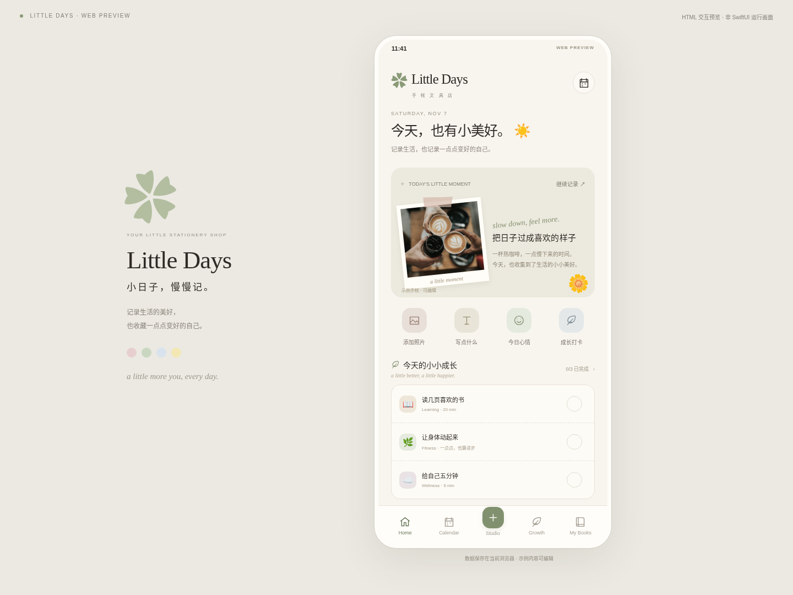

# Little Days · 手帐文具店

**记录生活的美好，也收藏一点点变好的自己。**

iPhone 数字手帐 App，原生方向为 **Swift + SwiftUI**；当前提供可交互的 iPhone 尺寸 **HTML Web 预览**，方便 Windows 开发与验收。Web 预览不是实际运行的 SwiftUI，没有改为 React。

## 在 Windows 打开最新版

安装 [Python 3.10+](https://www.python.org/downloads/windows/)（建议 3.11+）与 Git；安装 Python 时启用 Python Launcher。无需安装 Swift、Xcode 或 Node.js 即可预览。

首次下载，在 PowerShell 或命令提示符运行：

```powershell
git clone https://github.com/jessiethere/Notebook.git
cd Notebook
py -3 tools/preview.py
```

已有仓库，在仓库目录运行：

```powershell
git pull
py -3 tools/preview.py
```

打开 **http://localhost:8080**。也可双击 **Start-Windows.cmd**。如果没有 `py` 命令，改用 `python tools/preview.py`；端口被占用时运行 `py -3 tools/preview.py --port 8081`，打开 http://localhost:8081 。保持终端开启，按 Ctrl+C 停止；修改界面后刷新浏览器。

服务器只监听本机 127.0.0.1。localhost 是运行命令的这台电脑。macOS/Linux 同样可运行 `python3 tools/preview.py`；已有 Swift 服务入口仍可用 `bash start.sh`（Swift 6.0+，首次编译需联网）。

## 当前可以使用

- **Home**：当天日期、照片与手帐、快速记录入口、今日习惯、最近编辑手帐本和 Studio。
- **Calendar**：切换月份、查看/补记/编辑任意日期；Memory 照片标记与 Growth 打卡视图。
- **Growth**：自定义主题和习惯、完成/时长两种记录、周目标进度、历史日历、基础成长里程碑；按日期关联手帐。
- **Journal Studio**：Quick Create / Creative Mode；文字、心情、照片上传/替换、系统字体和三个模板；贴纸拖动/缩放/旋转/排序/删除；撤销/重做、自动草稿、保存与基础 PNG 导出。
- **My Books**：自定义手帐本名称、主题、封面颜色/图案，内容归类、查看和编辑。
- **本机保存**：刷新可恢复记录和草稿；初始示例明确标注，保存后成为自己的内容。



## 原生 SwiftUI 项目

`Native/LittleDays.xcodeproj` 是 iOS 17+ App 入口，依赖 `Native/` UI Package 与独立的 `Packages/LittleDaysCore/`。原生已建立五页导航、共享资源、文字/心情/模板、日期记录、默认打卡/周进度和本机文件保存的代码基础。

原生照片/贴纸编辑、自定义习惯和手帐本等能力尚未与 Web 对齐；当前 Linux 环境只检查 SwiftUI 语法、Package 清单、工程 plist 结构，**未进行 iOS SDK 编译或真机验证**。未来在 Mac 的 Xcode 16+ 打开工程，选择 iPhone Simulator 验证；这不影响 Windows 日常浏览器预览。

## 文档与目录

| 位置 | 内容 |
| --- | --- |
| [AGENTS.md](AGENTS.md) | 长期协作与强制日志规则 |
| [agent.md](agent.md) | 当前进度、详细日志、测试和下一步交接 |
| [docs/PRODUCT_SPEC.md](docs/PRODUCT_SPEC.md) | 全量需求、第一阶段范围、未完成事项 |
| [docs/DESIGN_SYSTEM.md](docs/DESIGN_SYSTEM.md) | 配色、字体、组件与创作风格 |
| [docs/ARCHITECTURE.md](docs/ARCHITECTURE.md) | 可行性评估、架构、共享契约和取舍 |
| [docs/ASSETS.md](docs/ASSETS.md) | 照片与素材来源 |
| `Public/` | 无构建步骤的 HTML/CSS/JavaScript 界面 |
| `Packages/LittleDaysCore/` | Swift 模型、规则、共享 JSON 与照片 |
| `Native/` | SwiftUI UI Package 与 iOS App 工程 |
| `tools/` / `tests/` | Windows 预览服务、颜色生成、测试 |

## 运行测试

Windows 的 HTTP 测试（仅需 Python）：

```powershell
py -3 -m unittest discover -s tests -p "test_*.py"
```

可选 Web 自动化测试需要 Node.js 22+；开发预览本身不需要 Node。先保持预览服务运行，再开一个终端：

```powershell
npm ci
npm test
npx playwright install chromium
npm run test:browser
```

默认浏览器测试连接 http://127.0.0.1:8080 。PowerShell 可用 `$env:PREVIEW_URL="http://127.0.0.1:8081"` 改测试地址。测试使用独立浏览器上下文，不改你日常浏览器的记录。

Swift 环境：根目录 `swift test --jobs 4` 验证 Vapor；`swift test --package-path Packages/LittleDaysCore --jobs 4` 独立验证共享 Core。修改颜色后运行 `python tools/sync_tokens.py` 并一同提交生成的 CSS。

## 已知限制与下一步

- 当前 Web 数据保存在本浏览器 LocalStorage，原生数据保存在本机 App 文件，两端尚未同步。清理站点数据、换浏览器或换端口不会保留同一份记录。
- 照片较多可能达到浏览器存储上限；失败会显示提示。建议导出重要创作，下一阶段引入更可靠的图片存储与备份。
- 尚未实现照片自由裁切/拖动/缩放/旋转、多照片、自由文本框、独立胶带/相框素材库；导出是基础版式，长文和字体可能与预览有差异。
- 还没有完整字体/原创素材商店、跨端同步、提醒、复杂成长统计及 App Store 发布能力。
- 测试环境为 Linux；Windows 实机、iOS SDK 编译与真机仍待验证。优先推进原生编译验证、照片裁切和自由编辑、媒体备份。

## 协作与会话接续

每次开始先读 AGENTS.md、agent.md、README.md，再检查最新代码、分支和提交；每次改动必须同步维护 **agent.md 和 README.md 的更新日志，并与代码一起提交**。保留旧日志。新聊天提供仓库链接并要求先读这三份文档即可接续。

## 更新日志

### 2026-11-07 — Little Days 第一阶段：SwiftUI 基础与 Windows 交互预览

- 在已有 Vapor 项目上新增 Little Days 产品、设计、架构文档；确立 SwiftUI 原生 + 轻量 HTML 预览，共享 JSON / Swift 数据模型与素材，无 React。
- 实现精致 Home 和五页导航，以及日期补记、习惯打卡、基础手帐编辑、草稿/导出与主题手帐本。
- 新增 Windows Python 启动方式、独立 Core Package、SwiftUI UI Package 和 iOS App 工程；保留 Vapor 启动与资源服务。
- 验证：6 项 JavaScript、3 项 Python、2 项 Core Swift、2 项 Vapor 测试全部通过（13 项）；Python/Vapor 两个入口的浏览器端到端流程通过，375/390/430 布局无横向溢出。原生语法/工程结构检查通过，iOS 编译与 Windows 实机未验证，详见 agent.md。
- 未完成：照片自由裁切/变换、完整原生编辑器与原生编译实测、可靠媒体备份和跨端同步。

### 2026-11-07 — 新增 Swift + HTML 本地预览框架

- 使用 Vapor 搭建 Swift 服务，提供 HTML 首页、静态资源和健康检查接口。
- 新增终端启动脚本、macOS 双击入口、端口切换和 Swift 工具链检查；默认访问 http://localhost:8080，无需打开 Xcode。
- 已在 Linux + Swift 6.0.3 编译成功，2 项后端测试通过；浏览器连接、断线提示、重连、移动端布局及启动脚本检查通过。用户个人电脑与 macOS 实机运行尚待确认。
- 下一步：确定并实现具体软件功能。

### 2026-11-07 — 建立跨会话交接机制

- 新增 agent.md，保存协作约定、当前状态、关键决定、未完成事项和详细日志。
- 新增 AGENTS.md，要求每次更新同步维护 agent.md 和 README.md。
- 验证：已核对文档文件名、相对链接及两处日志的一致性；本次仅修改文档，无应用代码可测试。
- 下一步：等待具体项目需求，继续按上述规则记录每次更新。
