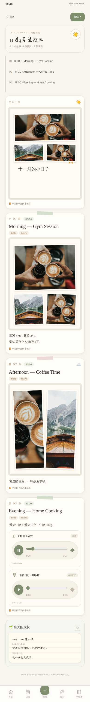
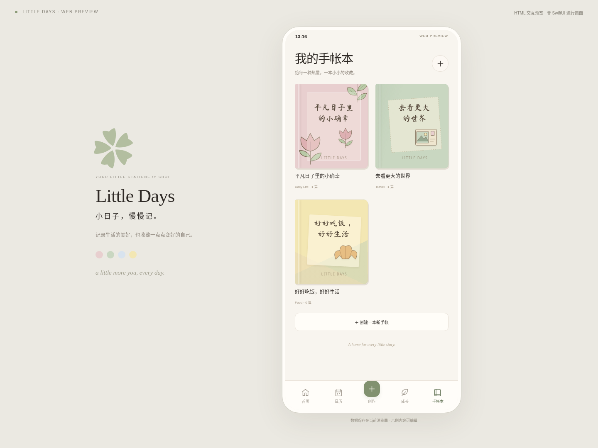

# 开铺手帐 · Capiday

> 中文名「开铺手帐」，英文名 Capiday（2026-11-14 起；原名 Little Days）。

**记录生活的美好，也收藏一点点变好的自己。**
**Collect moments, grow gently.**

## 👉 [点这里直接打开开铺手帐（在线链接）](https://claude.ai/artifact/VYUJ38K5TBqcZPB8VzJS7A)

> 不用安装、不用运行任何东西，点开就是最新版；只有你自己能打开（登录 claude.ai）。每次更新都会发布到这同一个链接。
>
> **随手就能打开的地方**：① 已固定（pin）在 claude.ai 左侧栏，名字是「开铺手帐 · Capiday」；② 项目文件夹里双击 **Open-Capiday.url**，直接用浏览器打开在线链接；③ 也可以把这个链接加到浏览器书签栏。
> 查看方式统一用这个在线链接；iPhone 上最终是 Swift / SwiftUI 外壳里运行同一个界面。
> 在线链接里不能录音、也不能下载备份/导出图片（浏览器安全限制）；需要这些功能时用下面的本机链接。数据只保存在当前浏览器里，和本机预览、iPhone App 互不相通。

备用（一般不需要）：本机预览 [http://localhost:8080](http://localhost:8080)，只在要录音、下载导出文件时用（双击 **Start-Windows.cmd** 启动）。

**在 Claude 桌面 App 里随时点击**：用 Claude 桌面 App 新建一个**本地**会话并选择 `Notebook` 文件夹，在 Browser 面板的 **Dev servers** 菜单里点 **Capiday (Windows)** 即可启动并打开（配置在 `.claude/launch.json`）。网页版/云端会话的侧栏目前没有这个服务器列表。

最新完成 **V3.1：自由排版、多事件日记、完整回忆浏览与成长感想**。

**架构：最终发布 iOS App；iOS App 是 Swift 外壳（SwiftUI + WKWebView），里面运行的就是 `Public/` 这一份 HTML/CSS/JavaScript。** 所以你在 claude.ai 固定链接里看到的，就是 iPhone 上会看到的同一个界面——点开链接就能检查每次更新、告诉我哪里要改，不需要每次用 Mac/Xcode。保留 Vapor 与共享 Swift Core；没有使用 React。

## 备用：本机 localhost 预览（一般不需要，查看更新请用上面的固定链接）

**在 Claude 会话里**：每次开始工作时，预览服务会在后台启动并登记为预览链接。直接点开会话里的 **localhost:8080** 预览即可看到最新代码，不需要下载任何东西。

**在你自己的 Windows 电脑上**（第一次设置一次，以后只需双击）：

1. 第一次：安装 [Git for Windows](https://git-scm.com/download/win) 和 Python 3.10+，在想放项目的文件夹里运行：

```cmd
git clone https://github.com/jessiethere/Capiday.git
```

2. 以后每次：双击 `Notebook` 文件夹里的 **Start-Windows.cmd**。它会先自动 `git pull` 拿到最新代码，再打开 **http://localhost:8080**。保持窗口开启，Ctrl+C 停止。

手动方式（在项目目录运行）：

```cmd
git pull
```

```cmd
py -3 tools\preview.py --open
```

没有 `py` 可用 `python tools\preview.py --open`。端口占用可用 `--port 8081`，但更换地址/端口会切换浏览器存储（先在 Settings 导出备份）。报错说明见 [Windows 指南](docs/WINDOWS_PREVIEW.md)。macOS/Linux：`python3 tools/preview.py --open`；Vapor 仍为 `bash start.sh`（Swift 6.0+）。

## iOS App（Swift 外壳）

- 入口 `Native/App/LittleDaysApp.swift` → `LittleDaysWebShellView`（`Native/Sources/LittleDaysUI/WebShell/`）。外壳通过 `littledays://app/` 加载打包进 App 的 Web 文件，并像 `tools/preview.py` 一样从共享 Core 提供 `/shared`、`/library`、`/assets`；数据保存在 App 自己的 WebKit 存储（LocalStorage + IndexedDB）。
- 外壳负责原生能力：`confirm/alert` 对话框、麦克风录音权限、相机/相册选择、备份与 PNG 导出保存到「文件」并弹出分享面板。
- 改完 `Public/` 运行 `python3 tools/sync_native_web.py` 把同样的文件同步到 `Native/Sources/LittleDaysUI/WebApp/`；`tests/test_native_shell.py` 会检查是否一致。
- 发布 iOS 时再用 Xcode 打开 `Native/LittleDays.xcodeproj` 构建；日常检查更新只需要上面的 localhost 链接。
- 早期的 SwiftUI 原型界面（`LittleDaysRootView` 等）保留在代码中，但 App 不再使用它们。**Swift 外壳尚未在 Xcode 构建或真机上验证**（当前环境没有 macOS/iOS SDK）。

## V3.1 新增（Web）

- **Calendar 回忆阅读（Day Detail）**：点有内容的日期，直接阅读当天全部 Moments、照片排版、文字/贴纸、心情、视频（直接播放）、音频与录音（设计感播放器：播放/暂停/拖动进度/时长）、成长打卡与感想；照片可放大；点 Edit 才进入 Studio。刷新或重选日期后从 IndexedDB 重新载入，离开页面释放临时 URL。日历格子用小圆点标记照片/视频/声音/成长，多个小故事显示数字。
- **多照片自由排版**：「添加照片」一次多选（单次最多 20 张），继续添加不会覆盖；每张照片可拖动、双指缩放旋转、鼠标拖右下角改宽高、拖顶部圆点旋转、滚轮缩放（Shift 旋转）、方向键微调；裁切、相框（拍立得/白边/圆角/无边框）、胶带、替换、复制、删除、前后/逐层顺序，全部可撤销重做，可与贴纸、文字框、成长卡片混排。
- **Auto / Free Layout**：双照片、三照片、四宫格、拍立得、拼贴；按照片数量自动建议；手动调整后再套模板会先提醒。
- **一天多个小故事（Moments）**：Studio「添加一个小故事」，每个有小标题、时间、正文、心情、标签、手帐本、照片/视频/录音和独立画布；可排序、复制、删除、折叠、单独保存。
- **Growth 感想**：打卡后点 ✎ 写内容/时长/感想/心情/照片，可随时回看修改；每周/每月回顾（全部可选）；感想可作为卡片插入手帐，修改感想会同步更新，不会重复计数；删除手帐页不会删除打卡。感想默认私人。



## 当前真正可用的 Web 功能

- **原有五页**：Home、Calendar、Growth、Studio、My Books；日期补记、每日习惯/时长、周目标、手帐归类、草稿与撤销/重做继续可用。
- **自由主题书本**：名称、描述、任意类别；创建后可继续编辑。六种封面有书脊/质感/边框、颜色、字体、原创装饰与上传照片。
- **通用记录字段**：文字、数字、日期、单选、复选框、时长、图片；Fitness/Recipe/Learning/Money/Skincare/Plant 预设，不为每个主题另写编辑器。
- **真实字体**：七款本地 OFL 字体，覆盖七种分类，含中文；实时预览、标题样式、独立正文字体、多文字框独立字体/大小/颜色/对齐/位置。保留旧系统字体和旧 Emoji 图层。
- **原创素材**：十类 23 个 SVG + 480px 透明 PNG；可拖动、缩放、旋转、复制、删除、排序。可额外加入自由变换的照片拼贴层。
- **视频与音频**：视频上传/设置封面/内嵌播放；音频上传/播放；麦克风授权后录音并保存。浏览器原生控制支持暂停、进度、时长、静音，刷新后可重开。
- **简体中文 / English**：Home 右上角 Settings 切换并保存偏好；界面、表单、状态双语，用户的书名、正文、文件名和媒体不翻译。
- **数据保护**：新媒体放进 IndexedDB，LocalStorage 存元数据和引用；旧主照片安全迁移。Settings 可导出/确认恢复完整本机备份；旧标签页更新会提示冲突。
- **始终私人**：新旧书本默认 Private，Public / Shared 暂禁用。没有联网社区、好友、私信或协作，不假装已经有服务端权限控制。背景音乐只有 App 自带的 8 首原创音乐（V6.0 / V6.2），不连接任何音乐平台。



## 原生 SwiftUI 与共享资源

`Native/LittleDays.xcodeproj` / `Native/Package.swift` 是 iOS 17+ 工程。App 入口现在是 Swift 外壳，所有功能与 localhost 版本一致；共享 Core（`Packages/LittleDaysCore`）的 Swift 数据模型同步了 V3.1 字段（Moments、照片布局、成长感想、周/月回顾），早期 SwiftUI 原型界面保留但不再作为入口。

浏览器里的数据（localhost）和 iPhone App 里的数据各自独立，不会自动同步，可用 Settings 的备份/恢复迁移。当前环境没有 macOS/iOS SDK，**Swift 外壳尚未进行 Xcode 构建、模拟器或真机验证**。

## 项目文档

| 文档/目录 | 用途 |
| --- | --- |
| [AGENTS.md](AGENTS.md) / [agent.md](agent.md) | 长期规则、详细交接与保留的历史日志 |
| [PRODUCT_SPEC](docs/PRODUCT_SPEC.md) | 完整 V3 需求、实际范围与限制 |
| [DESIGN_SYSTEM](docs/DESIGN_SYSTEM.md) | 配色、精致封面、字体、素材和双语规范 |
| [ARCHITECTURE](docs/ARCHITECTURE.md) | 当前架构/兼容策略，以及未部署的社交后端和权限设计 |
| [ROADMAP](docs/ROADMAP.md) | Phase 1–5 的详细任务与验收清单 |
| [STRATEGY](docs/STRATEGY.md) | 产品战略、竞品、优先级与待确认提案（任务 G） |
| [QUICK_EDIT_PLAN](docs/QUICK_EDIT_PLAN.md) | Quick Create / Quick Edit：标题选填（已实施）、换照片 · 写文字 · 换个排版、双照片排版（方案）；预览 https://claude.ai/artifact/Bj5uD5vtZAmtq9pwgv5f3B |
| [MEME_STICKER_PLAN](docs/MEME_STICKER_PLAN.md) | Meme 与贴纸工作室：Captain 小反应、我的 Meme 收藏、GIF（设计轮，待确认）；设计板 https://claude.ai/artifact/4EEpdtVnJ55zG3mrYdgkdK |
| [QUICK_CREATE_PLAN](docs/QUICK_CREATE_PLAN.md) | 差异化与 Quick Create v3 方案（待确认）；设计稿 https://claude.ai/artifact/Ex4FbaCRPNx9HZXNcuDuyt |
| [ASSETS](docs/ASSETS.md) | 素材来源、SIL OFL 和原创许可 |
| [Windows 指南](docs/WINDOWS_PREVIEW.md) | 无 Git 下载、启动、更新与故障排查 |
| `Public/js/` | 元数据、IndexedDB、通用 UI、素材、双语与图片导出模块 |
| `Packages/LittleDaysCore/` | 共享 Swift 模型/规则/JSON/字体/素材 |
| `Native/` | 原生 UI Package 和 iOS App 工程 |

## 本轮测试

最近一轮（2026-11-09）在 Linux 容器 + Chromium 验证：**118 项 Node、12 项 Python 全部通过**；`browser`、`v3`、`v31`、`v32`、`v33`、`v34`、`v35`、`v36`、`v37`、`v38`、`v39`、`v40`、`v41`、`v42`、`v43`、`v44`、`v45`、`v46`、`v47`、`v48`、`v49`、`v50`、`v51`、`v52`、`v53`、`v54`、`v55`、`v56`、`v57`、`v58`、`v59`、`v60`、`v61`、`v63`、`v64`、`v65`、`collab` 三十七套浏览器 E2E 全部通过（背景音乐只做了响度/频谱分析，未由人试听确认、也未在 iPhone 上播放；手绘未在真实 iPad / Apple Pencil 上验证；系统分享面板未在 iOS 真机验证），详情见 agent.md。本轮环境没有 Swift 工具链，**Swift Core 与 Vapor 测试未运行**；也尚未在 Windows 实机、iOS SDK、Safari/Firefox 上验证。

Python HTTP/启动测试：

```cmd
py -3 -m unittest discover -s tests -p "test_*.py"
```

可选浏览器测试需要 Node.js 22+，预览本身不需要。先启动 localhost，再开另一终端：

```cmd
npm ci
npm test
npx playwright install chromium
npm run test:browser
npm run test:browser:v3
npm run test:browser:v31
npm run test:browser:v32
npm run test:browser:v33
npm run test:browser:v34
npm run test:browser:collab
npm run test:browser:v35
npm run test:browser:v36
npm run test:browser:v37
npm run test:browser:v38
npm run test:browser:v39
npm run test:browser:v40
npm run test:browser:v41
npm run test:browser:v42
npm run test:browser:v43
npm run test:browser:v44
npm run test:browser:v45
npm run test:browser:v46
npm run test:browser:v47
npm run test:browser:v48
npm run test:browser:v49
npm run test:browser:v50
npm run test:browser:v51
npm run test:browser:v52
npm run test:browser:v53
npm run test:browser:v54
npm run test:browser:v55
npm run test:browser:v56
npm run test:browser:v57
npm run test:browser:v58
npm run test:browser:v59
npm run test:browser:v60
npm run test:browser:v61
npm run test:browser:v63
npm run test:browser:v64
npm run test:browser:v65
```

测试使用合成媒体与虚拟麦克风、独立浏览器上下文，不读取真实用户手帐。Swift 环境运行根目录 `swift test --jobs 4`，以及 `swift test --package-path Packages/LittleDaysCore --jobs 4`。变更设计颜色/字体目录后运行 `python tools/sync_tokens.py` / `python tools/sync_library.py`。

## 限制与下一步

- 视频单文件 50 MB，音频 20 MB，录音单次最多 5 分钟；格式兼容性取决于浏览器，当前验证 Chromium。浏览器原生媒体/日期控件的语言跟随浏览器设置。
- 新媒体在 IndexedDB，仍属本机站点数据，清理浏览器数据可能删除。完整备份媒体导出上限 100 MB，导入文件上限 150 MB；尚无分卷、加密或云备份。
- 静态 PNG 不包含可播放的音视频；导出与 DOM 排版存在差异。主照片自由裁切、滤镜、完整相框和高级信息卡片仍未实现。
- 没有真实用户账号、社区/好友/私信服务、协作角色与原子版本控制或流媒体音乐接入（背景音乐只有 8 首原创曲）（社区、好友、私信、共同创作目前是本机演示，标注“演示 · 未联网”）。旧标签页提示不等于多人协作。
- 优先做 Windows/iOS 平台实测与原生个人能力对齐；再按 Phase 2 做清楚标注的社交原型，Phase 3 服务端，Phase 4 协作，Phase 5 高级创作/授权音乐。

## 协作与会话接续

开始任务先读 AGENTS.md、agent.md、README.md 与三个规范文档，再检查最新代码/提交。每次修改必须同步维护 **agent.md 与 README 日志，并随代码提交**。保留历史，禁止将私人内容、备份或密钥提交到公开 GitHub。

## 产品方向（Vision 2.0，2026-11-10）

**Capiday — Your life, a little world growing with you.**

- 产品围绕 **Today（首页）· Calendar（日历）· My Books（书架）· Journal Studio（写一页，从 ＋ 进入）**。独立的 Growth 模块已经移除，不会再加回来。
- **Little Keeper**（**V7.7 已实现 MVP**：可选、默认关闭；收藏品小世界仍在计划中）：一个可选的小伙伴，随你记录生活自然成长；它的小世界里的物件代表真实的记忆（例如旅行手帐的第一页 → 一张明信片）。不需要追踪任何东西，没有每日任务和连续天数惩罚，可以关掉；只用日期、手帐本类别 / 标签等元数据在本机计算，不读取、不上传正文。
- 详见 [docs/PRODUCT_VISION_2.md](docs/PRODUCT_VISION_2.md)。

## 更新日志

### 2026-11-14 — 书里的按钮改成「分享」（V10.48）

- 「分享给家人看（PDF）」改成「分享」，分享给谁都可以。
- 分享完不再弹出「想让 TA 也能往这本书里加照片吗？」的问卷。

### 2026-11-14 — 照片分组与排序：方案和设计稿（还没有改 App）

- 新的方向：「自动建议，用户决定」。选完照片后先选「按时间建议分组 / 全部放在一页 / 自己分组」，在预览里合并、拆分、长按拖动，确认后才生成页面；已保存的手帐也能把照片移到另一页、合并、拆分、排序，都能撤销。
- 方案：`docs/PHOTO_GROUPING_PLAN.md`；设计稿（中英文、375 / 430 宽）：https://claude.ai/artifact/9keLMFJh3q5vwTfaSycKo2 。等你确认后再分三步实施。

### 2026-11-14 — 一天的页面可以全部删除，不会留下删不掉的封面（V10.47）

- 删到最后一页时会先问「删除这一页后，这一天将没有记录。」，确认后这一天变成空的，重启后也不会回来；提示条和日历上可以「恢复刚删除的这一天」。
- 页面目录只有真的有封面时才显示封面行，旧的封面不会丢，由你决定删不删。
- Studio 标题里的页数和阅读器、日历、书架一致。
- 已在网页和 iOS 模拟器（真实触摸，包括关掉 App 再打开）验证。**真机要上传新的 TestFlight 构建（0.1.0 (2)）后确认。**

### 2026-11-14 — 手绘在 iPhone 上画完可以正常退出、选中和保存（V10.46）

- 修好了 TestFlight 上发现的问题：手绘板顶部的「取消 / 完成」被 iPhone 状态栏挡住、点不到，所以画完卡在画板里。
- 手绘的空白处不再挡住下面的照片和文字；有新笔画时点「取消」会先问；保存失败会让你重试。
- 已在网页和 iOS 模拟器（真实触摸）里验证，包括关掉 App 再打开。**真机要上传新的 TestFlight 构建后再确认。**
- 详细记录见 `docs/BUGFIX_LOG.md`。

### 2026-11-14 — 第一次上传到 App Store Connect

- 0.1.0 (1) 已上传，商店名称 Capiday 已预留（App ID 6834636756）。下一次构建号自动是 2，并且不再问出口合规问题。
- 中文商店名「开铺手帐」也已保存。下一步：用 TestFlight 装到 iPhone 上测试。

### 2026-11-14 — 改名为开铺手帐 / Capiday（V10.45）

- App 名字从 Little Days 改为中文「**开铺手帐**」、英文「**Capiday**」。中文界面写开铺手帐，iPhone 主屏幕在中文系统下显示开铺手帐；首页字标、页面刊头和导出文件名用 Capiday。GitHub 仓库现在是 https://github.com/jessiethere/Capiday ，Xcode 显示名 Capiday、Bundle ID `com.capiday.app`。
- 手帐、照片、设置和以前的备份都不受影响（内部存储名没改）。
- 已发布到固定链接（第 102 版）；浏览器回归全部通过；iOS 模拟器里中英文检查通过，主屏幕显示新图标和「开铺手帐」。真机还没测。
- App 图标换成了你提供的新 Capiday 图标（同样的 Captain 构图）。

### 2026-11-13 — S1–S4 在 iOS 模拟器里验证；V10.44 发布到固定链接

- 模拟器（iPhone 17e，中文和英文）：新安装只有一本空的「我的手帐」→ 三张照片 → 3 页，没有自动封面 → 换照片时用这一天已有的照片（不重复保存）→ 加可选封面 → 在阅读器隐藏 → **重启 App 后**都还在，并且可以重新显示。
- 没有在模拟器里测：真实的相册选择界面、PDF、375 宽。**真机还没有测过。**
- 全量浏览器回归 81 个套件全部通过（一处旧测试按新的「页」计数规则更新了期望值）。
- 已发布到固定链接（第 101 版）。

### 2026-11-13 — 每日封面变成可选的（V10.44）

- 新的一天不再自动生成封面；需要时点「＋ 封面（可选）」，用当天照片，不重复导入。
- 旧封面保留；阅读器「···」可以隐藏或重新显示（不删除）；备份照常包含。
- 测试：新增 v144 浏览器 6 项。

### 2026-11-13 — 换照片可以直接用已经导入的照片（V10.43）

- 快速编辑和 Studio 的「换照片」：这一页 / 这一天 / 这本书 + 从相册添加；复制引用，不重复保存，说明留在原位置，可撤销。
- 测试：新增 v143 浏览器 6 项。

### 2026-11-13 — 页数在每个地方都一样了（V10.42）

- 书写「几天 · 几页」；日历、日详情、阅读器、PDF 用同一条规则数页；书本封面不算页。
- 测试：新增 v142（单元 3 项 + 浏览器 2 项）。

### 2026-11-13 — 你的手帐只装你自己的记录（V10.41）

- 新装只有一本空的「我的手帐」；书架不再有家庭建议卡。
- 旧示例保留但不出现在书、日历、阅读、搜索、统计和 Captain 里；设置 → 示例内容 可以查看。改过的示例算你的。
- 测试：新增 v141（A–E 五种场景 × 中英文）。

### 2026-11-13 — 方案：照片复用、每日封面可选、示例数据隔离（App 界面没有变化）

- 方案板：https://claude.ai/artifact/AKgX2gu88hRidRkKB9fQGo ，包括真实根因、数据结构、三组界面预览、分批计划。等待确认后实施。

### 2026-11-13 — 方案：分卷备份与恢复快照、真机测试步骤、Editorial 排版系统（App 界面没有变化）

- 三份方案在 `docs/BACKUP_FORMAT_PLAN.md`、`docs/DEVICE_TEST_PLAN.md`、`docs/EDITORIAL_SYSTEM_PLAN.md`，都在等确认，还没有实施。
- iOS 模拟器里确认：第一次打开会跟随系统语言（英文 / 中文都试过），没有示例页，首屏能看到「选今天的照片」。真机未测。

### 2026-11-13 — 备份：只有真的存好了才算备份（V10.40）

- 有文件读不出来时列出清单，可取消或导出标明「不完整」的备份，不会当成完整备份；恢复时其他内容照常恢复。
- 导出后确认「存好了」才记下这次备份；取消分享不再算已备份。
- 测试：新增 v140（单元 2 项 + 浏览器 6 项）。分卷备份与恢复快照只出方案，未实现。

### 2026-11-13 — 第一次打开：干净的手帐，照片入口一眼可见（V10.39）

- 新装不再混入示例页/示例日子/示例习惯；老手帐的示例保留不删。
- 第一次打开跟随手机语言；老用户保持原语言。
- 375 宽首屏能看到「选今天的照片」；Keeper 邀请在第一页之后、照片卡下面。
- 不再自动弹连续记录；习惯/成长轨迹/我的习惯收进实验功能（数据保留）。
- 测试：新增 v139 浏览器 3 项。iOS 上系统语言识别未在模拟器验证。

### 2026-11-13 — 长文字不会再被截断（V10.38）

- 快速编辑和 Journal Studio 都去掉了 70 / 120 字上限，写多少保存多少；长文字自动排成正文。
- 一页放不下时给分页建议：照片留第一页，文字按句子接到下一页，确认后才分。
- 测试：新增 v138（单元 4 项 + 浏览器 6 项），快速编辑相关 14 个旧套件通过。以前已截断的文字无法恢复。

### 2026-11-13 — 切出 App 时刚写的字会马上保存（V10.37）

- 切到别的 App、锁屏、关闭页面时立即保存；编辑中原本的自动保存不变。
- 「已保存」只在真正写进数据库后显示；失败显示「还没保存」，可重试。
- 测试：新增 v137 浏览器测试 8 项。真机（系统杀进程时）未验证。

### 2026-11-13 — 手帐暂时打不开时，App 会停下来保护它（V10.36）

- 只有真正第一次使用才会新建手帐；数据库打不开、格式来自其他版本、最新副本损坏时，App 停在说明页面，不写入、不覆盖。
- 可以重试、保存原始数据副本；有较早完整副本时可确认后用它继续（损坏的一份先保留）。
- 测试：新增 v136（单元 6 项 + 浏览器 12 项），原有单元测试 272 项通过。真机未验证。

### 2026-11-12 — 在你的 Mac 上试通了 Captain × 本机 Qwen 聊天（仅开发用，在线链接里看不到变化）

- 在浏览器里打开 `?dev-local-ai=qwen3.5:4b` 后，和 Captain 闲聊由你 Mac 上的 Qwen 回复，旁边标着「本机模型 · 开发」；发出去的只有聊天里的几句话，不含手帐内容。
- 问「你会做什么」或「帮我整理今天的故事」仍然走原来的规则；模型没开或连不上时，Captain 自动改用原来的回复；`?dev-local-ai=off` 可以关掉。
- 如果 Xcode 里还开着服务端（`NotebookServer`），它会占着 8080：`bash tools/mac/dev.sh web` 现在会提示你先在 Xcode 里按 ■ Stop，不再打开一个错误页面。

### 2026-11-13 — Captain：打开就知道现在可以做什么（V10.35，第 98 版）

- 打开 Captain，最上面是一张小卡片：一句适合现在的话，加上一两个点了就会做的按钮。
  - 还没记录：〔选照片〕〔随手写〕；
  - 刚收好一页：〔写一句话〕或〔继续编辑〕，以及〔看看成品〕；
  - 今天已经记过：〔翻翻今天〕；
  - 刚翻完以前的一天：〔继续翻阅〕。
- 不再列四行固定功能。想整理今天、回顾以前，直接在聊天里说。
- 请 Captain 代写时，它会直说还不会，并给你能直接开始的按钮。
- 每次打开换一句话。

### 2026-11-13 — 在 iOS 模拟器里用 iPhone 字体检查了自动排版（这次 App 界面没有变化）

- 在你的 Mac 上，用 iPhone 模拟器（375 中文、430 英文）把 8 种排版情况走了一遍，全部合格：照片不会被挤小，字不压照片，太多的时候建议分页。
- 发现 iPhone 的宋体比电脑浏览器多占一行。App 是按 iPhone 上真实的字体来排的，所以这一页在 iPhone 上自动换了排法，结果仍然合格。
- 「今天怎么记？」在模拟器里检查过：视频、声音、自由排版在第一屏，「取消」不会被底部挡住。
- 截图在 Mac 的 `/tmp/ld-build3/l4/out`。

### 2026-11-13 — 自动排版：照片不再被挤小、字不压照片；放不下一页时建议分页（V10.33 / V10.34，第 97 版）

- 排版时按你选的字体和字号量出文字真实占几行。很高的截图和 Meme 会留得更宽，上面的字看得清；照片不裁切。
- 长的一句话用正文大小显示，不缩小、不截断；照片下面的字和照片一样宽，不再压到旁边的照片。
- 「换个排版」只给出合格且不同的排法。
- 照片和文字实在太多时，「今天的故事」底部会出现建议卡：现在的一页和分开后的每一页并排给你看，〔分成 2 页〕或〔保持一页〕由你选。不会自动加页，已保存的页面不会重新排版。
- 修复：换照片后再调整照片分组，旧照片会回来的问题。
- 还没做：在 iOS 模拟器里用 iPhone 字体核对（你的 Mac 现在连不上）。

### 2026-11-13 — 「今天怎么记？」视频、声音、自由排版一打开就能看到（V10.32，第 96 版）

- 视频、声音、自由排版在三张主卡片正下方，打开就能看到。
- 「照片 + 一句话」还是第一张、最显眼的卡片。第一次打开时默认选它，之后会记得你上次用的方式。
- 选「视频」后按钮变成「选一段视频」，直接打开视频导入；书和日期不变。
- Captain 新版设计（按你的文案）在设计页：https://claude.ai/artifact/KgAuNDg4mgsgKYhUbDyj1A ，确认后再做。

### 2026-11-13 — 设计方案：照片不再被挤小、放不下时建议分页；Captain 四种状态；视频入口不用往下找（还没开始做）

- 方案和真实截图：https://claude.ai/artifact/KgAuNDg4mgsgKYhUbDyj1A （可以切换 375 中文 / 430 English）。
- 排版：
  - 每张照片有最小尺寸，文字不压照片，一大两小时下面两张也要看得清；
  - 一页放不下时，先换排法，实在不行就建议分成两页，给你预览，由你决定。
- Captain：
  - 不再列四行固定入口；
  - 按「今天还没记 / 刚做完 / 今天已记 / 刚在看旧手帐」显示一句话和一两个能直接点的按钮。
- 「今天怎么记」：视频、声音、自由排版移到三张卡片下面，打开就能看到。
- 详细说明：`docs/LAYOUT_QUALITY_PLAN.md`、`docs/CAPTAIN_UX_PLAN.md`、`docs/QUICK_ENTRY_PLAN.md`。

### 2026-11-13 — 在 iOS 模拟器里检查快速编辑；按钮固定在屏幕底部（V10.31，第 95 版）

- 在 iOS 模拟器里走了一遍：选两张照片、换第 2 张、撤销、换排版、写文字、保存、阅读器。流程都正常，阅读器里没有选中框。
- 发现高屏 iPhone 上，换照片 · 写文字 · 换个排版 · 保存 这排按钮停在页面下方、下面空一大块。现在固定在屏幕底部。
- 键盘和手指触控还要你在手机上试：`docs/QUICK_EDIT_IPHONE_CHECK.md`。

### 2026-11-13 — 完整回归；照片配长文字的排版修复（V10.30，第 94 版）

- 两张照片配一段长文字：照片排成均衡的一对，文字放在下面，第二张不会再被挤得很小。
- 很多张照片配长文字：所有照片排成整齐的几行，不会缩成邮票大小。
- 回归测了这些情况，都通过（Chromium 浏览器测试 70 / 70）：
  - 1–5 张照片、各种比例；
  - 没字、短字、长字；
  - 替换、撤销、保存后重开；
  - 在快速编辑和「自定义」之间来回切换；
  - 旧页面不被重排。
- 还没测：iPhone 上的触控、键盘和阅读器。请按 `docs/QUICK_EDIT_IPHONE_CHECK.md` 试一次，约 5 分钟。

### 2026-11-13 — 快速编辑：换照片、写文字、换个排版（V10.29，第 93 版）

- 「今天的故事」底部是：换照片 · 写文字 · 换个排版 · 保存；「自定义」在右上角。
- 点页面上的照片就能选中它，然后「替换这张照片」，不用进「自定义」。
  - 这张照片的文字、整页的字体和风格都保留，可以撤销；
  - 自己调整过的页面，新照片放在原来的位置。
- 「写文字」一打开就能输入；字体与样式默认收起；不写也能保存。
- 「换个排版」有三个排版小图，下一行是杂志 / 手账 / 拼贴；换任何一项都不丢照片和文字。

### 2026-11-13 — 两张照片的排版更均衡（V10.28，第 92 版）

- 杂志风格里放两张照片、没写标题时，不再一张大一张小，旁边也不再空着一栏。
- 自动在并排、上下、错落三种排法里选最合适的一种：
  - 按照片形状、占满页面的程度、两张大小是否均衡来选；
  - 照片不裁切，截图上的字完整保留。
- 横图配竖截图这类形状差很多的两张，小的那张会适当放大。
- 「重新排版」在三种排法之间切换。
- 已保存的页面、你在「自定义」里调整过的页面不会被自动重排。

### 2026-11-13 — 标题完全可选（V10.27，第 91 版）

- 不起标题也是完整的一页：日历、书架、首页、编辑器、阅读器里都不再出现「未命名的一页」。
- 没有标题时按内容显示，比如「11:05 · 2 张照片」或你写的那句话的开头；这只是显示方式，不会替你填标题。
- 日历里这一天的每页都有小图，点一行直接打开阅读器里的那一页。
- 想起名字时点「起个名字（选填）」；删掉标题后又会按内容显示。
- 阅读器里的照片不再出现蓝色焦点框。
- 换照片 / 写文字 / 换个排版的快速编辑，以及两张照片的新排版，还只是方案：https://claude.ai/artifact/Bj5uD5vtZAmtq9pwgv5f3B ，等你确认。

### 2026-11-13 — 先把「一分钟做出一页手帐」做稳：P0 验证、检查更准确（V10.26，第 90 版）、核心流程 Audit

- 固定链接第 90 版：「检查照片和视频」不再把 iPhone 上没打开检查的视频说成「解码失败」；导入视频失败时，本机记录会写清具体原因。
- 在 iOS 模拟器里用 App 自己的保存路径测过：
  - 照片保存后，关掉 App 再打开，照片还在；
  - 用备份恢复的视频，关掉 App 再打开，文件还在，封面也正常。
  - 用脚本导入视频没成功：iOS 要求用户先点击，真实操作还要手动验证。
- Claude App 里的验证步骤见 `docs/P0_MEDIA_TEST.md`（约 5 分钟，只用测试照片和视频）。根因还没确定。
- 核心流程 Audit：https://claude.ai/artifact/XQudn5EW31Nc7jb6kWFgEw （`docs/CORE_FLOW_AUDIT.md`）。
  - 现在 5 次点击就能完成，估计 30–45 秒；
  - 7 个小问题等你确认后再改，例如「写一句」被挡住、写好的一句话太小。
- Meme 设计 v2 已通过，按新的优先级暂不实施，只做了任务拆分。

### 2026-11-13 — Meme 与贴纸工作室：最终设计 v2（还没开始做）

- 设计板第 2 版：https://claude.ai/artifact/4EEpdtVnJ55zG3mrYdgkdK （9 个画面，375 / 430，中文 / English）；文字版 `docs/MEME_STICKER_PLAN.md`。
- 改动：
  - ★ 统一：贴纸、Captain、我的 Meme 都能收藏；最近用过的不会自动收藏；
  - 第一阶段只导入静态图（PNG / JPG / WebP），选到 GIF 会说明「下一版支持」，不会偷偷转成静态图；
  - Captain 先做原色 6 个小反应，现在都是占位。
- 查到：现在的照片导入会把 GIF 转成只剩一帧的 JPG；iOS 模拟器的相册本身不会转换。iPhone 上的选择器还没测，可以用设计板第 9 节的「GIF 选择测试」在 Claude App 里试。
- 设计板第 9 节还有「存储保持测试」，用来确认关掉 Claude App 后本地数据还在不在。
- App 本身这次没有变化，固定链接仍是第 89 版。

### 2026-11-13 — Meme 与贴纸工作室：设计稿（还没开始做）

- 设计板：https://claude.ai/artifact/4EEpdtVnJ55zG3mrYdgkdK （375 / 430，中文 / 英文）；文字版 `docs/MEME_STICKER_PLAN.md`。
- 打算：贴纸面板分成 贴纸 / Captain / Meme & GIF / 我的收藏；可以导入自己的表情图（先静态，再 GIF），导入后先预览，再选「放到这一页」或「只存进收藏」；GIF 默认不动，点了才播。
- Captain 的 6 个小反应还没有正式素材，设计稿里都是标明「素材制作中」的占位。
- App 本身这次没有变化，固定链接仍是第 89 版。有 8 个决定等你确认。

### 2026-11-13 — V10.25 已发布到固定链接（第 89 版）

- 打开上面的固定链接就能看到编辑器整理后的样子；设置 → 更新记录里有 10.25 这一条。
- 小屏手机上「更多」面板稍微矮了一点，纸张保持至少 120px 高（375×667 上是 136px）。
- 全量浏览器回归 66 个脚本：先有 3 个因为「本页照片」入口去掉、面板高度而失败，已修好并重跑通过。iPhone 实机还没看。

### 2026-11-13 — 编辑器整理：选中什么就改什么，「更多」分三组（V10.25）

- 选中照片、文字、视频或贴纸后，工具栏上方写着「照片 · 已选中」，第一个按钮是「← 返回」；× 只用来关面板。
- 形状、字体、颜色、对齐、图层改成细选项条，纸张只缩小一点。图层只放上移、下移、置顶、置底、复制，精确数值收在「精确调整」里。贴纸可以「换一个」。
- 「更多」分成三组：页面外观、媒体与创作（手绘排第一）、页面管理。「目录」和「页面管理」合并成「页面目录」，可以复制页面；「本页照片」已去掉。
- 操作指南改为四步：加东西、摆位置、改它、改整页。
- Captain Playroom：剩下的玩法都要新的动画素材。下载文件夹里的那个 GIF 和仓库里已有的绿领巾版是同一个文件，所以这次没有改动。

### 2026-11-13 — 心情记在每一页上，背景和纸张互相替换（V10.24）

- 心情在「页面信息」里选（「更多 → 心情」也能打开）：开心、温暖、平静、低落、雀跃，可以更改或清除，不会画到纸上。新的一天不再自动带 ☀️；以前的日子不改动。
- 选背景会替换纸张，选纸张会替换背景，不用先撤销。
- 打字时，字体和 B I U S 工具条贴在键盘上方（Chromium 里模拟过，还没在 iPhone 上看过）。
- 小修正：「贴纸」「排版」的名字统一了；形状面板不再有跳去「更多」的返回箭头；加照片后不再弹提示挡住纸张。

### 2026-11-12 — 导入视频看得到每一步，换封面就在视频下面（V10.23）

- 导入视频时，页面上会有一张卡片，依次显示：读取信息 → 导入进度 → 正在保存到本机 → 生成封面 → 已保存到本机。保存期间页面条会变淡，并提前写明暂时不能切换页面。保存失败时会说明原因，并提供「重试」；超过 50 MB 的视频会直接拒绝。
- 选中视频后的工具：播放 · 换封面 · 形状 · 图层 · 移除。「本页媒体」里，换封面和从页面移除就在视频正下方，375 和 430 宽的手机上都不用滚动。
- 换封面会显示现在的封面，拖动时间轴选一帧，点完成保存；不会改动原视频，阅读模式里也用新封面。「从页面移除」会先确认，也可以撤销。
- 自测：Chromium 和 Mac 上的 WebKit 都覆盖了 7 秒的视频、接近 50 MB 的视频、导入时切换页面、超过上限、保存失败后重试、换封面、阅读器、刷新、关闭浏览器重开、375 / 430，全部通过。iOS 模拟器里能构建、能启动。**还没在你的 iPhone 上验证。**

### 2026-11-12 — 新增「检查照片和视频」（V10.22，P0 排查）

- 在固定链接里打开：设置 → 数据与隐私 → 检查照片和视频。它会逐个检查这台设备上用到的照片和视频，告诉你是哪一类问题，并显示运行环境（浏览器内核、运行地址、是否嵌在其他页面里、存储会不会被自动清理）。只读取，不改动、不删除、不上传任何东西；可以复制结果发给开发者。
- 自测：
  - Chromium 和 Mac 上的 WebKit 各跑了 23 个检查点，全部正常：一张照片 / 多张 / 视频、草稿后重进、完成后重进、刷新、关闭页面重开、关闭浏览器重开、开发服务器重启；
  - iOS 模拟器里能构建、能打开检查面板。
- **还没在你的 iPhone 上复现，根因仍未确认。**请在出问题的 iPhone 上打开这个检查，复制结果给我。
- Mac 合并：你的 Mac 上已经把 e529a0e rebase 并推送为 49479dd，核对过没有丢东西；Mac 上未提交的 Xcode 工程文件和 Qwen 结果没有动。

### 2026-11-12 — 工具整理方案第二版 + 媒体保存问题的验证结果（App 未改）

- 方案页（同一个链接，第 2 版）：https://claude.ai/artifact/5yrXLwKVD9cFvkjf6TPxKr 。已按你的六项决定更新，有 375 / 430 中英文预览、返回和删除的规则，以及键盘位置的对比。
- 媒体保存问题：
  - 在 Mac 的 WebKit（Safari 引擎）里，新旧两版代码都复现不出 Error，所以根因还没确认；
  - 防护性修复（V10.21）已经上线；
  - iOS 模拟器里新版本能启动，但「从相册加照片」这一步还没测。
- 需要你回答三件事：在哪里看到 Error、整天心情的旧数据怎么处理、Mac 上要不要合并。

### 2026-11-12 — Journal Studio 工具整理方案（等确认，App 未改）

- 预览页：https://claude.ai/artifact/5yrXLwKVD9cFvkjf6TPxKr ；文字版：`docs/STUDIO_IA_PLAN.md`。
- 内容：
  - 现在所有工具的入口和问题；
  - 新的三层结构：四个创作工具 → 选中对象的工具 →「更多」分三组；
  - 六个常见任务的前后对比；
  - 375 / 430 中英文预览（Chromium 模拟，不是真机）；
  - 分 5 个阶段的实施计划和回归清单。
- 等你回答方案里的 6 个问题后，再开始改界面。

### 2026-11-12 — V10.20 / V10.21 已发布到固定链接（第 85 版）

- 在固定链接里打开「设置 → 更新记录」可以看到 10.21（照片视频存储修复）和 10.20（形状 / 裁剪 / 排版分开）。
- 自测：单元测试 206/206，全部 62 个浏览器测试通过（Chromium，不是 iPhone）。
- 未完成：iPhone / iOS 模拟器验证；导航图标、背景与纸张、Mood 三项补充需求。

### 2026-11-12 — 照片和视频存得更牢，出问题会如实提示（V10.21，P0 修复）

- 问题：在 iPhone 上加了照片 / 视频，离开 Studio 再回来显示 Error。
- 修改：照片和视频现在按原始文件内容存进本机，存完立即读回核对；以前存的照片视频第一次打开时自动转成新存法（同一编号，不删除任何东西）。
- 「已保存」只有在这一页的照片和视频都确实存在时才显示；否则显示「保存失败」并说明几个文件需要重新添加，文字照常保存。
- 真读不到的照片显示「照片读取不到」，不会显示别的图片；加载失败时会自动重新读取一次。
- 备份包含照片和视频本身，恢复到另一台设备后能打开。
- 自测：Chromium 新增 11 组持久化回归测试全部通过（离开再进来、刷新、关闭浏览器重开、阅读器、旧数据、缺失文件、备份恢复、杂志模式）。**尚未在 iPhone 或 iOS 模拟器上验证**，根因是代码审查推断（iOS 上存进 IndexedDB 的 Blob 可能失效），Chromium 里无法复现。
- 已经在手机上失效的旧照片无法在 App 内找回，请从相册重新添加，或从之前的备份恢复。

### 2026-11-12 — 照片的形状和裁剪分开了，裁剪可以直接拖框（V10.20，进行中）

- 选中照片后，下面是：形状、裁剪画面、调整、替换、图层、删除。形状只改外框，「裁剪画面」决定显示照片的哪一部分。
- 裁剪画面是全屏的：拖四个角调整范围，拖动照片换取景，双指缩放，可以选比例（外框、自由、原比例、1:1、3:4、4:3、9:16、16:9），还能旋转 90°。取消不会改变任何东西，原图一直保留。
- 加照片后不再自动打开「排版」。照片多于一张时会出现一条「试试排版」的提示，不理会也可以。

### 2026-11-12 — 杂志模式：每张照片写一句，直接换字体（V10.19）

- 「Aa 改文字」改成以照片为主：上面一排是真实照片，标着 1、2、3，点哪张就给哪张写一句；也可以写一句给整个 Moment。拍摄时间一样的照片也分得清。
- 每句话都排在它那张照片的下面，换风格、重新排版、调整分组都不会跑到别的照片旁边。
- 字体（宋体、黑体、楷体、文楷……）、大小、加粗、颜色、对齐直接在同一个面板里改，上面的页面马上就变；进入「自定义」后也保留。
- 点页面上的照片，会直接打开那张照片的文字。

### 2026-11-12 — Captain 听得懂更多日常的话了（V10.18）

- 以前网页版 Captain 对大多数日常的话只会说「没太懂」。现在问它名字、喜欢吃什么，说你饿了、好忙、无聊、紧张、睡不着、想家、考砸了、升职了、过生日，它都会接上合适的话。
- 告诉它你做了什么（「今天吃了火锅」），它会用你的话接着问下去。不知道写什么时，它会给你一个小题目。
- 仍然不是 AI，全部在你的设备上完成，你的话不会发到任何地方。复杂的句子它还是听不懂。

### 2026-11-12 — Captain 本地对话正式评测；装到你自己 iPhone 的步骤

- 在你的 Mac 上正式跑了 Captain 本地模型（qwen3.5:4b）第 3 版说法：结果和之前的试跑一致。不再「喵」，不声称看过你的手帐，换语言的回复都会被 App 拦下改用规则回答。每句约 0.4 秒。详细回复和评分见 docs/captain-ai/results/2026-11-12-prompt-v3-formal.md，请你复核评分。
- 装到自己 iPhone 的 8 个步骤写在 docs/MAC_LOCAL_DEV.md「安装到你自己的 iPhone」，用免费 Apple ID 就可以。

### 2026-11-12 — Mac 同步完成，所有测试通过

- 你的 Mac 已经同步到最新代码，你自己没提交的文件都没动。备份还在 `~/Documents/Developer/Notebook-checkpoints/2026-11-12/`，确认不需要后可以自己删除。
- 在你的 Mac 上：Swift 核心测试 6/6、网页逻辑测试 191/191 全部通过，iPhone App 在模拟器里构建成功。

### 2026-11-12 — 你的 Mac 已同步到最新，iPhone App 构建成功

- 你 Mac 上的 Notebook 已经快进到最新，你自己没提交的 `Package.resolved` 和两份评测结果都没有动（备份在 `~/Documents/Developer/Notebook-checkpoints/2026-11-12/`）。
- iPhone App 在模拟器里构建成功，Captain 的「玩耍」在 App 里能玩：点毛线球，Captain 会接住并开心大笑。
- Swift Core 的测试文件里有一处 11 月 9 日就存在的写法错误，导致测试一直没能编译，这次已经修好。

### 2026-11-12 — 和 Captain 玩毛线球（V10.17）

- Captain's Corner 的「玩耍」变成一个大舞台：
  - 按住粉色毛线球拖到 Captain 爪子边松手，Captain 会抱住它开心大笑，播完回到原样；
  - 丢到别处，球会自己滚回来；
  - 点一下毛线球，它会自己滚过去；
  - 戳戳 Captain，也会看到它开心的样子。
- 柠檬帽和无帽都能玩，各用各的画。无帽版现在只有静态画，戳它会开心地跳一下。
- 不用带绿领巾的动画。摸摸头、挠肚皮先收起来，等正式素材。
- 无帽版的动画还需要你从 ChatGPT 下载后放进 `docs/brand/captain-anim/`，文件清单见 docs/ASSETS.md。
- 打开固定链接 https://claude.ai/artifact/VYUJ38K5TBqcZPB8VzJS7A ，点首页的 Captain → 「玩耍」。

### 2026-11-12 — V10.16 最后一次细节打磨（V10.16.1）

- 欢迎页（只在实验室里出现）换上 App 图标和带小芽的 Little Days 字标，去掉像素小花和散落的表情；还没开放的 Apple / 邮箱登录放在「实验室 · 还没有开放」的虚线框里，不能点。
- 五种字母印记的字母大小、线条粗细统一了；选中的印记只有一圈细细的绿色描边。
- 确认：正式版（没开实验室）不会出现欢迎页和「社区」标签，底部只有首页、日历、写手帐、书架。
- 可以在固定链接 https://claude.ai/artifact/VYUJ38K5TBqcZPB8VzJS7A 里看：设置 → 编辑资料；欢迎页要先在 设置 → 实验室 里打开，再点设置里的「回到欢迎页」才能看到。

### 2026-11-11 — iPhone App 在你的 Mac 上构建验证通过

- iOS 17 的修复验证过了：服务端的包和 iPhone App（Debug、Release）都构建成功，模拟器里能看到新版编辑资料。
- 每台模拟器都是一部独立的手机，App 要分别安装。在 Xcode 里选好机型再按 ⌘R，或者运行 `bash tools/mac/sim-shots.sh "iPhone 18 Pro Max"`。

### 2026-11-11 — Captain's Playroom 设计预览（等你确认）

- 「玩耍」页的新设计：Captain 大大地在中间，气泡邀请你陪它玩毛线球，按钮在下面；还没画好的摸摸头和挠肚皮只占两个浅色小按钮，界面上不再写开发说明。方案见 [docs/CAPTAIN_PLAYROOM_PLAN.md](docs/CAPTAIN_PLAYROOM_PLAN.md)，里面有 5 个问题等你确认。
- 你给的两段 Captain 动画已经存进项目（docs/brand/captain-anim/），确认设计后再接进 App。

### 2026-11-11 — 头像换成个人标记；日详情音乐默认静音；同一天多页可直接打开（V10.16）

- iPhone App 构建报错（LittleDaysCore 要求 iOS 17，某个目标却是 15.0）找到了原因：在 Xcode 里打开项目根文件夹时，加载的是本机服务端的包，它没写 iOS 版本。现在所有地方统一为 iOS 17。另外新增 `LittleDays.xcworkspace`，双击就能打开 iPhone App 工程。这个修复还要在你的 Mac 上实际构建确认。
- 编辑资料：五种字母印记（纸片、朱印、牛皮纸、鼠尾草、手写）加上小芽，没选时显示小芽。不再提供系统 Emoji，但已经在用的 Emoji 头像会保留，并显示为「现在的头像」。欢迎页只有名字和当前头像，挑选头像在设置里。
- 日详情的背景音乐和阅读器一样：默认不响，点了才播放。
- 书本页里，同一天有好几页时，下面会显示这一天的每一页，点哪页就在阅读器里打开哪页。
- Captain 的「摸摸头、挠肚皮、玩毛线球、换帽子、换衣服」都要等正式美术，缺少的素材记录在 docs/ASSETS.md。

### 2026-11-11 — 模拟器里的「空白页」查清了（仅开发用，在线链接里看不到变化）

- 在 Xcode 里请打开仓库根目录的 `LittleDays.xcworkspace`（或 `Native/LittleDays.xcodeproj`）。之前打开仓库根目录会报「requires minimum platform version 17.0 … supports 15.0」，那是本机预览服务器的工程；这个报错已经在上面的 V10.16 修好了。
- 空白页不是坏了：模拟器刚开机时 App 要等系统准备好，可能需要半分钟以上；平常打开约 1–2 秒到首页。
- 开发用的 Debug 构建现在会把网页报错和启动用时写进 Xcode 控制台，方便排查。正式（Release）版本里没有这段代码。

### 2026-11-11 — 开发用 Captain 本地对话第 3 版（V10.15，在线链接里看不到变化）

- 在你的 Mac 上用本机 Qwen 跑了三版对比：第 3 版不再「喵」，也不反复提帽子、尾巴和阳光，夸它时知道是在夸自己。对比和评分见 [docs/captain-ai/results/2026-11-11-prompt-v1-v2-v3.md](docs/captain-ai/results/2026-11-11-prompt-v1-v2-v3.md)。
- 模型用错语言回答时（比如你说中文它回英文），App 不显示这句，改用 Captain 原来的回答。
- 在模拟器里确认：操作指南的绿色圆环已经对准纸张。

### 2026-11-11 — iPhone App 第一次在模拟器里跑起来（V10.14）

- 在你的 Mac 上用 Xcode 27.2 第一次构建 iPhone App：没改工程就成功，在 iPhone 18 Pro 模拟器里首页、日历、书架、写手帐都能打开。以后运行 `bash tools/mac/sim-shots.sh` 就能自动构建并截这四个页面。
- 修好了：操作指南的绿色圆环在 iPhone App 里会偏低一截，现在会跟着纸张走。
- Captain 本地模型对话（只用于开发）换了第 2 版说法：不再一直「喵」，不猜手帐里写了什么，不劝你去写。要在 Mac 上重跑评测确认效果。
- 未完成：App 冷启动要 15–20 秒才到首页（原因还没查）；App 里的本地 AI 聊天还没在 Mac 上打开试过。

### 2026-11-11 — 在你的 Mac 上跑通了环境和本地 Qwen（仅开发用，在线链接里看不到变化）

- 环境检查全部 ✅：M5 / 24 GB、Xcode 27.2、iOS 27.2 模拟器、Ollama 和 `qwen3.5:4b`。经你同意后装了 Homebrew 和 Node.js，并把 Xcode 设回默认开发工具（Homebrew 安装时会改掉它）。
- 本地 Qwen 能用：Captain 每句回复约 0.5–2 秒，模型大约占 5–9 GB 内存。
- Captain 的 12 句测试每句跑了 3 次，人工评分 86%。最明显的问题是太爱说「喵」，偶尔说出没根据的话（如「今天的小日子还空着」）。结果见 [docs/captain-ai/results/2026-11-11-qwen3.5_4b.md](docs/captain-ai/results/2026-11-11-qwen3.5_4b.md)。
- **还没有做的**：在浏览器里打开本地 AI 聊天、第一次用 Xcode 构建 iPhone App、调整 Captain 的提示词。

### 2026-11-11 — 预览服务常驻

- 云端会话里的预览服务（8080，名称「Little Days」）启动后会一直开着，可以在 App 会话的 environment / 预览里直接打开。容器重启后由 Claude 重新启动。

### 2026-11-11 — 准备在 Mac 上开发（V10.13，仅开发用，在线链接里看不到变化）

- 新增 [docs/MAC_LOCAL_DEV.md](docs/MAC_LOCAL_DEV.md)：在你的 Mac 上检查环境（`bash tools/mac/doctor.sh`），在本机运行 Qwen（Ollama），运行 Captain 的中英文测试（`bash tools/mac/dev.sh eval`），在 Xcode iPhone 模拟器里运行真正的 App（`bash tools/mac/dev.sh sim`），以及每天的开发流程。
- Captain 可以在开发时接入本机的 Qwen（`bash tools/mac/dev.sh web-ai`）：默认关闭，只在本机地址上能打开；只发送你在 Captain 面板里打的那句话，不发送手帐、照片或声音；模型没启动时照常用规则回答；回复不会写进手帐。
- **还没有做的**：这次的会话在云端运行，连不到你的 Mac，所以 Qwen 实测、Xcode 构建和模拟器截图都还没有做。下一步请在 Mac 上打开 Claude（桌面 App，或在仓库里运行 `claude remote-control`）继续。

### 2026-11-11 — 排版更顺手：双击就能写字（V10.12）

- 轻点文字框是选中，双击直接开始写，下方「编辑」也还能用。按住框内任何地方拖动都只会移动它，手指轻微抖动不再算移动。
- 控制点移到框外：上方 ↻ 转角度，角上的圆点改大小。不再盖住文字，两个控制点的触控范围不重叠，转过角度的框也好用。
- 文字颜色修好了：打字时点工具条上的颜色圆点展开色块（以前在 375–390 宽的手机上色块被挤到点不到）；「颜色」面板里当前颜色有勾选标记；新增橄榄绿和纸白。
- 第一次打开编辑器有三步小引导（移动、双击编辑、控制点），可以跳过，只出现一次；之后在「更多 → 操作指南」可以再看。已经写过手帐的人不会因为更新被重新教学。第一次选中文字框时有一句「双击即可编辑文字」的提示。
- 引导指向整张纸时，卡片放在底部工具栏上，尽量不挡纸张。
- 未完成：iPhone Safari 真机的双击、键盘弹出和选词还没有实测（这次是 Chromium 触屏模拟）。

### 2026-11-11 — 翻开一本手帐：全屏阅读（V10.11）

- 书本页的主按钮是「开始翻阅 / 继续翻阅 · 第 N 页」，点封面也能翻开；「记录新的一页」和 PDF 分享在下面。
- 全屏阅读：底部导航收起，书页保持 4:5 不裁切；封面写「封面 · 共 8 页」，内页「第 1 / 8 页」…「第 8 / 8 页」。
- 左右滑动或点边缘翻页，点中间显示 / 隐藏按钮；双击照片放大，双指也能放大整页；视频和声音点了才播放。
- 背景音乐默认不响，点 ♪ 才播放。
- 列表里点某一天直接翻到那一页；「所有页面」可跳到任意一页；长文字有「阅读全文」。
- 在阅读里编辑，完成或保存草稿后回到同一页；新写的一页保存后直接在阅读里打开；记得读到哪一页。
- 未完成：iPhone 真机的手势手感未验证；当天页的背景音乐仍会自动播放。

### 2026-11-11 — 设置页的小打磨（V10.10）

- 没起名字时显示「我的小世界」和「给这个世界起个名字吧」，头像是一株小嫩芽；起名后显示首字，选过的头像保留。
- Captain 更大一些，多了「和 Captain 玩一会儿」，打开 Captain 的小角落。
- 数据与隐私：备份与恢复放在最前面，每行一句说明；完整说明都在「隐私说明」里。
- 实测 375 / 393 宽 iPhone 尺寸：字号、行距、触控区和底部导航都检查过。主题和语言不变。

### 2026-11-11 — Captain 更懂你在说什么了（V10.9）

- 夸它、谢谢它、想摸摸它、问它在干嘛，都有自然的回应；只有问「你会做什么」才介绍功能；听不懂时老实说没太懂。
- 「今天有点累，但是写完了一页」会先认可你写完了；还没写、打算写、开心、难过也分开回应。
- 没有开启「翻看以前的页面」时，Captain 不说出页面标题，也不再说「偷偷多看了两眼」。
- 面板变成 Captain 的小角落：聊天 / 玩耍（准备中）/ 装扮；高度固定不跳动，可展开；聊起来后快捷操作收成一行。
- 仍然没有 AI。编辑资料的新设计预览在 docs/PROFILE_EDITOR_PLAN.md（等待确认）。

### 2026-11-11 — Captain 可以换装扮了（V10.8，第一步）

- Captain 面板名字下面的「装扮 ›」和设置 →「角色与装扮」里可以换造型，一点即换，首页、面板、书架一起变。
- 现在有两个造型：柠檬帽、抱毛线球（不戴帽）。没有金币、签到或解锁。
- 小花夹子、毛线帽、青蛙帽、睡帽、围巾、铅笔、围裙还没有画稿（Captain 只用正式画稿），画好后加入素材库即可出现。
- 未完成：帽子和配件目前不能叠加（画稿是整只 Captain 的成品图）；iPhone 真机未验证。

### 2026-11-11 — 离开编辑器：完成手帐、保存草稿，或继续编辑（V10.7）

- 编辑时点返回会问「要先收好这一页吗？」：完成手帐 / 保存草稿 / 继续编辑。两种保存都不会丢内容。
- 顶部同时显示「已保存」（已存到本机）和「草稿 / 已完成」（这篇做没做完）；自动保存照常。
- 草稿有低调的「草稿」标签（首页、书本页面列表、翻页、当天页面），当天页面上可「继续编辑」，回到离开时的那一页。
- 右上角「完成」与面板里的「完成手帐」是同一个操作。保存失败时不会提示成功，也不会离开。
- 以前用返回离开、没点过「完成」的日子现在显示「草稿」。
- 未完成：没有草稿汇总列表；iPhone 真机未验证。

### 2026-11-11 — 文字可以只给几个字加粗、斜体、下划线（V10.6）

- 纸上打字时的文字条、选中文本框时的「字体」面板里多了 B / I / U / S（加粗、斜体、下划线、删除线）。
- 选中几个字再点，只有这几个字变；可以叠加；没有选区时点一下，接下来打的字带这个格式。
- 点格式键不丢选区；撤销 / 重做有效；保存、刷新、再次编辑后都在；预览、阅读、导出一致；旧手帐不受影响。
- 粘贴进来的内容只保留文字。中文斜体显示为倾斜。
- 示例页：设置 → 更新记录 → V10.6 →「放一页格式示例到今天，试试看」。
- 未完成：iPhone / Safari 上的选区保持和中文输入法没有实测；颜色、字号、字体仍是整段级别。
- 另：全屏 Book Reader 的设计方案在 docs/BOOK_READER_PLAN.md（只是设计，等待确认）。

### 2026-11-11 — Captain 面板：发送更清楚，没发出去的话不会丢（V10.5）

- 输入框右边是明显的「发送 ↑」按钮；没有字时点不了。关闭只有右上角的 ×，或把面板往下拉。
- 打了字没发就关掉，文字会留着；关闭不会自动发送。
- 回车是换行；中文输入法选字时不会误发；发送后先显示「正在想」，不能重复发送。
- 未完成：真实 iPhone 的软键盘和中文输入法没有实测。

### 2026-11-11 — 设置页重新整理：My Little Days · 本机个人空间（V10.4）

- 设置页从 12 张大卡片改为五组细行：个人资料、Little Keeper、外观与偏好、数据与隐私、关于与更多；整页长度不到原来的一半。
- 顶部如实写明「本机个人空间 · 资料和手帐只保存在这台设备，没有云端账号」；「编辑资料」可改名字和头像；默认头像是名字首字，选过的头像保留。
- Little Keeper 只留预览和一行陪伴方式；改名等细项在「角色与装扮」。主题颜色是一行圆形色板。
- 「AI 小管家」标「尚未接入」，开关不能打开；没有任何 AI 调用。
- 更新记录、功能介绍、许可证、示例内容、测试记录、实验室在页面最下方，点开才显示。
- 「退出登录」改为「回到欢迎页（数据保留）」，只在实验室的登录页开启时出现。
- 未完成：没有在 iPhone 真机上验证；头像不能上传照片；没有真实账号和同步。

### 2026-11-11 — Captain 会看情况说话了（V10.3，不用 AI）

- 首页 Captain 旁多了「找 Captain」标签；点它或点 Captain 都打开同一个面板。
- 第一句话看今天的情况（几页、几张照片、最后一页的名字、是否很晚、隔了几天），一周内不重复。
- 面板里可以说几句（不会的会直说），可以「整理今天的故事」和「回顾以前的回忆」，都在这台设备上完成。
- 保存后的回应去掉了固定的动作后缀，改说这一页本身的事。
- 没有接入任何 AI：「帮我写一句话」如实标为尚未开放。AI 的评测准备在 docs/keeper-eval/。
- 未完成：没有在 iPhone 真机上验证。

### 2026-11-11 — 评估与设计：Little Keeper 互动与 AI 小管家、Settings V2（未改代码、未接入模型）

- Little Keeper：审查了现有固定文案的问题，提出三层陪伴和「找小管家」快捷面板（四个操作），评估了 Qwen API 的接入、成本和隐私方案。说明见 docs/KEEPER_AI_PLAN.md。
- Settings V2：新的个人资料区、Keeper 预览、外观与偏好、数据与隐私、关于与更多；功能映射见 docs/SETTINGS_V2_PLAN.md。
- 设计稿在画布 https://claude.ai/artifact/4tXVQfHSSPvQxJZqJFPTUG 。App 本身没有变化（仍是 V10.2），等确认后再实现。

### 2026-11-11 — 首页往下滑：今天的故事、今天的小计划、我的手帐（V10.2）

- 「今天的故事」：同一天的几页排成一页回忆（只是展示，不改动任何一页），下面每页一行；显示「收藏于 · 手帐名」；纯文字是日记纸；今天没记录时显示邀请和「最近的故事」。
- 「今天的小计划」：待办和习惯收成一行，默认收起，展开 / 收起会记住。
- 「我的手帐」：最近在写的那本放大，其余小一号；「我的书 / 共同的书」切换在书架页。
- 标题跟随中英文；修复英文小屏上顶部小字撑宽页面。
- 未完成：没有在 iPhone 真机 / Safari 上验证；5 张以上照片没有单独版式。
- 查看方式：打开 Claude 固定链接 https://claude.ai/artifact/VYUJ38K5TBqcZPB8VzJS7A ，在首页往下滑。

### 2026-11-11 — 设计探索：首页整条滚动体验（未改代码）

- 顶部不变；「今天的回忆」改成一页排好版的故事，待办和习惯收成一行（点开才展开），书架改成一层小书架、突出最近在记的那本。
- 设计稿和新旧对比在画布 https://claude.ai/artifact/4tXVQfHSSPvQxJZqJFPTUG ，说明见 docs/HOME_SCROLL_PLAN.md。
- App 本身没有变化（仍是 V10.1）；等确认后再实现。

### 2026-11-11 — 选中什么就出现什么工具（V10.1，第二步）

- 点照片 / 文字 / 贴纸，底部工具换成它自己的（照片：替换 · 裁切 · 调整 · 图层 · 删除；文字：编辑 · 字体 · 颜色 · 对齐 · 图层 · 删除）；左边的 × 回到四个工具。纸上的黑色浮动菜单取消。
- 「随手写」「照片+一句」的标题和正文可改字体、字号、颜色、对齐；「转为自由文字框」会带着样式变成可拖动的文字框，不重复、不丢字，可撤销。
- 修复：面板里的输入框点了会丢光标。
- 未完成：页面管理 / 页面信息的新样式、字号滑杆、纸面裁切框、贴纸替换；没有在 iPhone 真机 / Xcode 上验证。
- 查看方式：打开 Claude 固定链接 https://claude.ai/artifact/VYUJ38K5TBqcZPB8VzJS7A 。

### 2026-11-11 — 写手帐的页面重新整理（V10.0，第一步：外壳）

- 纸张变大、不用上下滚动；顶部只有 返回 · 页面名 · 保存状态 · 预览 · 完成；底部四个工具 照片 · 文字 · 贴纸 · 更多。
- 背景、版式、字体、手绘、视频、音频、心情、目录、页面管理、页面信息都在「更多」里；分享和导出在「预览」里。
- 撤销 / 重做在纸张左下方，按页面分开，切页后不会改到别的页面。
- 顶部显示 已保存 / 保存中 / 保存失败；失败时留在编辑页，可重试。「完成」保存并回到刚保存的那一页（只读），不会自动公开。
- 未完成：选中照片 / 文字 / 贴纸时的底部专用工具（下一步 Phase B）；页面管理和页面信息的样式还是旧的；没有在 iPhone 真机 / Xcode 上验证。
- 查看方式：打开 Claude 固定链接 https://claude.ai/artifact/VYUJ38K5TBqcZPB8VzJS7A ，首页点「开始记录」进入编辑页。

### 2026-11-11 — 设计探索：Journal Studio 交互重设计（未改代码）

- 新编辑器方案：默认只有顶部（返回 · 页面名 · 预览 · 完成）、一张大纸和底部四个工具（照片 · 文字 · 贴纸 · 更多）；选中照片 / 文字 / 贴纸时底部换成对应操作；其他工具收进「更多」面板；页面名、手帐本、日期时间收进「页面信息」。
- 所有现有功能都有新位置，对照表见 docs/STUDIO_UX_PLAN.md；设计稿在画布 https://claude.ai/artifact/4tXVQfHSSPvQxJZqJFPTUG 。
- 等确认后再实现。

### 2026-11-10 — 换背景更好找（V9.2）

- 写一页时纸面下方新增「背景」按钮；底部工具栏的「纸张」改名「背景」。
- 修复 iPhone 上打字后底部工具栏不再出现的问题。

### 2026-11-10 — Captain 对话泡泡与面板字号（V9.1）

- 修复首页点 Captain 时文字竖排的问题，改成带小尾巴的对话泡泡；书架上的泡泡同步。
- 「认识 Little Keeper」和改名字面板统一字号，两个按钮一样大。

### 2026-11-10 — 首页 V9.0（Phase 1，方向 A）

- 新首页：大日期 + 一句问候；「照片手帐」是唯一主入口（纸页卡片 + 两张拍立得，Captain 从上沿探头）；只写几句 / 手绘 / 更多方式收进一条文具栏；今天的回忆是一张大拍立得，只显示真实记录。
- 小屏幕上照片不压文字和按钮；所有原有入口和功能保留。
- 接下来按顺序：日历 → 书架 → Keeper 设置 → 品牌一致性检查。

### 2026-11-10 — 正式 App Icon（V8.1）

- iPhone App 换上确认的正式图标（戴柠檬帽探头的 Captain、小花回形针、Little Days 字样）：1024 × 1024 不透明正方形，直接用原图，iOS 自己加圆角。
- 网页 favicon 和「添加到主屏幕」图标也换成同一张图。
- 原图保存在 docs/brand/，`python3 tools/make_app_icon.py` 可重新生成全部尺寸。
- 还没有在 Xcode / 真机上验证。

### 2026-11-10 — 设计探索：新视觉方向与首页入口三方向（未改代码）

- 本轮只做设计稿，App 没有改动。设计画布：https://claude.ai/artifact/4tXVQfHSSPvQxJZqJFPTUG
- 内容：整体视觉方向（Cozy Editorial × Collectible Stationery）、首页快捷入口 A / B / C 三个方向、新日历和新书架、Little Keeper V2 三角色统一系统和设置页。
- 等确认方向并补齐 Natural 形象等美术素材后再实现。

### 2026-11-10 — Captain Keeper V1：只保留 Captain，重新精细抠图（V8.0）

- 本轮只有 Captain（灰蓝小猫、柠檬帽）；小兔、小西高地和其他帽子先下架。
- 四张图（默认、开心、睡觉、探头）从「Captain 角色视觉标准」重新抠图：保留柔和毛尖，没有白边、残留背景、闪光线或 zZ。
- 首页：Captain 从「今天」卡片上沿探出头，爪子搭在边上；不再自己说欢迎语，点它才说一句，5 秒后消失；可以在设置里关闭。
- 修复：和 Captain 聊天时回复被挤成一个字一行。
- 分辨率受参考图限制，正式版建议美术提供高分辨率透明 PNG；眨眼等动画需要动画帧，尚未实现。

### 2026-11-10 — Little Keeper 改用确认的 3D 角色图（V7.9）

- Keeper 不再用代码画，直接使用用户提供并授权的 3D 角色图：每个角色单独裁切成透明图片（20 张），整张角色表不进 App。
- 首页：Captain 用参考图里真正的「探头」姿势，头和爪子搭在今天卡片上沿；尺寸低调，首页结构不变；晚上 10 点后换睡觉图。
- 小伙伴：小兔、Captain 猫（默认名 Captain）、新加小西高地；设置里可以换帽子。
- 还缺美术素材：小兔 / 小西高地的探头、「写字」动作、小兔睡觉 / 兴奋、Captain 和小西高地的鼓励、更高分辨率图。缺图时用最接近的真图，不用代码代替。
- 对比图、详细测试见 agent.md；角色视觉规范见 docs/DESIGN_SYSTEM.md。

### 2026-11-10 — Little Keeper 毛绒新造型；首页「小本子」（V7.8）

- 小伙伴改成毛茸茸、大眼睛、从本子上方探出头的造型（小猫戴柠檬毛线帽，小兔戴雏菊花环）。
- 首页卡片像一本带铁环和缝线的小本子：顶部「Hi，名字！今天是星期几」+ 日期牌；四个插画入口（照片手帐 / 只写几句 / 手绘 / 更多方式）；品牌小芽和标语；照片卡贴纸胶带。
- 修复：设置里备份后媒体用量不再变空白。

### 2026-11-10 — Little Keeper（可选小伙伴）+ 首页问候 + 标签 Top 3（V7.7）

- **已完成（网页 / 在线链接可用）**：首页「Hi，名字！今天是星期几」；Little Keeper：小兔 / 小猫、起名、三种方式（安静 / 温柔 / 互动），首页气泡、写字时安静、保存后盖章、主动请求才有的回应（本机生成，不发送）、互动聊天（回看需另外授权）、书架上的它、三个成长阶段（按天计、不惩罚、不看情绪）；书架标签只显示最常用 3 个 +「更多」搜索。
- **未完成 / 计划中**：真 3D 角色与更多动画（需要美术素材）；接入安全的 AI 服务或 iOS 端侧模型；故事小世界收藏品；Swift 外壳未编译、未真机验证。不需要任何密钥或 Apple 开发者额外配置（没有联网功能）。

### 2026-11-10 — 产品方向 Vision 2.0 与 Little Keeper 方案（文档）

- 记录新的产品方向与 Little Keeper「Grow Through Living」方案（docs/PRODUCT_VISION_2.md）。只是文档，没有改功能、导航或数据；等待批准后再实现。

### 2026-11-10 — 搜索、那年今天、每日提醒、手帐本标签（V7.6）

- 首页 / 日历的放大镜：搜索写过的字、#标签、习惯感想、做完的事和手帐本，结果高亮，点开那一页。
- 首页「1 年前的今天」（还没满一年时「一个月前的今天」），× 今天隐藏。
- 设置「每天的提醒」：自选时间，「今天有什么值得记的？」，今天记过就不打扰，通知上可直接关闭（iPhone App 本地通知，Swift 代码**未在 Xcode / 真机验证**；网页里不提醒）。
- 手帐本标签：编辑手帐本时填写，书架按标签筛选，搜索也能搜到。

### 2026-11-10 — 备份提醒 + 记录存储升级（V7.5）

- 自己记了 3 天以上且没备份 / 14 天没备份时，首页一行提醒「现在备份」，× 一周后再提醒；设置里显示上次备份。
- 文字和页面改存进 IndexedDB（和照片一起），原来的浏览器小仓库满了也能保存；首次打开自动搬迁。

### 2026-11-10 — App 锁（V7.4）

- 设置 →「隐私」→「App 锁」：4 位密码（只存加盐哈希），离开立即 / 1 分钟 / 5 分钟后再锁；输错 5 次暂停 30 秒。
- iPhone App 里可用面容 ID / 触控 ID 解锁，App 切换器只显示「Little Days」封面（Swift 代码已写，**未在 Xcode / 真机上编译验证**）。
- 说明：这是防止别人随手翻看的锁，不是数据加密。

### 2026-11-09 — 习惯「✎ 编辑」里可以删除（V7.3）

- 「我的习惯」每个习惯下面有「✎ 编辑」：编辑习惯，或删除这个习惯（先确认，打卡一起删除）。
- 修好习惯小图标跑到卡片外面的问题；小屏上底部按钮不再被截掉。

### 2026-11-09 — 隐私保护（V7.2）

- 今日清单默认不进导出图片和分享 PDF；需要时在设置 →「隐私」打开。
- 设置 →「隐私」可让首页隐藏今天的照片和文字（只显示记了几页）。
- 「隐私」里写明：内容只在本机、照片不留拍摄地点、不连第三方、无广告追踪、社区为本机演示。
- 未完成：App 锁（Face ID / 密码）、视频元数据清除。

### 2026-11-09 — 阅读页的今日清单移到页面后面（V7.1）

- 打开某一天时，「今日清单」放在这一天的页面后面，改为简洁的 ✓ 列表（习惯和做完的事同一种样式）；点习惯那行看或写感想。

### 2026-11-09 — 首页「今天」卡片按照片滑动（V7.0）

- 今天放进页面的每张照片各一张卡（带那页的标题），只有文字的页面也有一张；左右滑，下面圆点跟着走。即使今天只有一页、里面有几张照片，也能一张张滑着看。

### 2026-11-09 — 今天要做的事 8 件；今日清单进导出（V6.9）

- 「今天要做的事」最多 8 件。
- 导出图片和整本书 PDF 时，每天第一页下方多一条「今日清单」（打卡的习惯 + 做完的事），不盖住页面。
- 翻书页上的今日清单现在会显示打卡习惯的名字。
- 习惯保留在「我的习惯」，首页一行入口。

### 2026-11-09 — 首页「今天要做的事」；更新记录搬进设置（V6.8）

- 首页的习惯列表换成空白的「今天要做的事」：写下要做的、做完打勾（最多 5 件，人人可用）。
- 习惯保留在「我的习惯」（书架上 / 首页一行入口「我的习惯 · 今天 x/y ›」），打卡在那里。
- 首页不再放「新版本」卡片：有更新时设置齿轮上有小红点，设置 →「更新记录」看这次改了什么。

### 2026-11-09 — 拖动互换照片、替换照片；杂志风格更像杂志（V6.7）

- 「我的习惯」里每个习惯「⋯」：改名、改目标、删除（先确认，打卡记录一起删）。
- 补记：首页「忘了记？补记昨天」；昨天拍的照片自动记到昨天，预览里可改日期。
- 主题配色人人可用（不再只在实验室）；字体加默认黑体 / 宋体 / 楷体（设备自带字体，无需许可证）。
- 封面编辑去掉纸下重复的「今天的标题和文字」框；纸上打字后可立即撤销。
- 保存后直接翻到刚写好的那一页（手帐本翻页视图），不再跳回首页。
- 首页「今天」卡片可左右滑动，下方圆点：一页页预览今天写的字和照片，点一下打开那一页。
- 「今天怎么记？」选「图库」直接显示照片网格；选「我的相册」后取消会回到原处（首页或面板），不留空白页。
- 纸上打字时换字体只改正在写的标题或正文（和字号、颜色一样分开）。
- 首页「Aa Just write」去掉「Aa」，就是「Just write / 只写几句」。

- 自定义里把一张照片拖到另一张上，两张互换位置（各自按比例放进对方的框，不裁切）。
- 照片工具条新增「替换」：位置不变，框跟着新照片的比例调整。
- 杂志风格：每页刊头小标「— 08:10 · MORNING」、更大的标题、页脚刊号；当天跨页有 LITTLE DAYS 刊头和大号日期。

### 2026-11-09 — 成长合并进「今天」（V6.6，任务 G）

- 底部导航变成 首页 / 日历 / ＋ / 书架（实验室打开时还有社区），不再有单独的「成长」。
- 首页「今天」卡片里一点就打卡；「我的习惯」在首页链接和书架上都能打开（成长之书、统计、每周回顾、习惯设置都在里面）。
- 打卡和做完的事会以「今日清单」便签出现在那一天的阅读页和翻书页上。
- 实验室：「今天想做的事」最多 5 件，不提醒、不自动顺延，第二天可手动「搬到今天」。

### 2026-11-09 — Quick Create V2：选完照片就是一页好看的手账（V6.5）

- 流程变短：选照片 → 自动按时间分组 → **直接看到排好的初稿** → 可选写一句 → 保存。写字、调分组都是可选的。
- 新的 Scrapbook 排版引擎，三种布局逻辑不同的风格：**杂志**（默认，大主图 + 衬线字 + 不对称留白）、**手账**（拍立得 + 胶带 + 手写字 + 牛皮纸）、**拼贴**（错落叠放 + 柔色背景 + 贴纸）；几个 Moment 的一天有「当天跨页」。
- 页面上的文字绑定到 Moment 自己的文字：预览、阅读、自由编辑改的都是同一份。手动调整过的页，换风格 / 重新排版前会先问。
- 改进前后对比与 5 个场景 × 3 种风格的真实截图在 `docs/images/quick-create-v2/`。
- 任务 G（成长合并 + 轻量「今天想做的事」）已确认，排在下一轮。

### 2026-11-09 — 今天的故事更好看：一整套配色（V6.4，Quick Create v3 第二步）

- 一天所有页用同一套配色（奶油 / 樱花 / 鼠尾草 / 牛皮纸），默认跟书的颜色走，预览里可以一次换整天。
- 一张照片的页默认大图；每页最多 2 枚贴纸，只放在空白角落；长句子自动变小、最多两行（导出图片和 PDF 一致）。
- 修复：导出图片 / PDF 时文字图层按自己的宽度和左右对齐来画（之前封面时间线导出会错位）。

### 2026-11-09 — 今天的故事：选照片，自动排成一天（V6.3，Quick Create v3 第一步）

- 首页最上面「今天有什么值得记录？」+「选今天的照片」，不用先选书、模板或字体。
- 照片按拍摄时间自动分成几个 Moment，可以挪照片、从某张分开；每个 Moment 写一句（可跳过）。
- 自动排成「封面时间线 + 每个 Moment 一页」，可以换一种、自己调整；保存后直接翻到书里今天这几页。
- 按设计稿 https://claude.ai/artifact/Ex4FbaCRPNx9HZXNcuDuyt 实现了第 ①–④、⑥ 屏；底部导航还没改成 4 个（和任务 G 一起做）。

### 2026-11-09 — 查看方式改为固定链接；Quick Create v3 方案（文档，待确认）

- 以后统一用 claude.ai 固定链接查看修改后的 App；localhost 只是备用。
- 新增 [docs/QUICK_CREATE_PLAN.md](docs/QUICK_CREATE_PLAN.md)：差异化分析、Quick Create 旅程、7 个排版模板、技术增量、优先级、15–20 人验证方案；6 屏 iPhone 设计稿：https://claude.ai/artifact/Ex4FbaCRPNx9HZXNcuDuyt 。没有改 App 代码。

### 2026-11-09 — 竞品补充：My Diary（文档）

- docs/STRATEGY.md 竞品表新增 My Diary：和我们重叠的是「日记 + 照片/视频/录音 + 日历 + 贴纸」，不同的是我们把照片自动排成好看的页，再做成一本可以翻、可以分享给家人的书。

### 2026-11-09 — 更多音乐风格、音量、整本书配音乐（V6.2）

- 新增 3 首原创音乐：清晨钢琴、晴天（欢快）、咖啡馆一角（爵士 + 咖啡馆背景声），一共 8 首。
- 选音乐的面板里有音量条（这台设备记住）。
- 书的页面可以「给这本书配音乐」：打开这本书、看它的某一天时播放；页面自己的音乐优先。导出视频也会带上。
- 「成长」合并和「今天想做的事」（planner）的产品方案写在 docs/STRATEGY.md 任务 G，**等你确认后再做**。

### 2026-11-09 — 看到哪页，就在哪页编辑（V6.1）

- 用「翻页」看书时，每页下面有「✎ 编辑这一页」；在日历里看一天时，每页右上角有「✎ 编辑」。
- 改完「保存」或返回，回到刚才看的那一页（不再跳回首页）。示例页没有编辑按钮。

### 2026-11-09 — 给页面配一首背景音乐（V6.0）

- 新增 5 首 Little Days 原创轻音乐（午后咖啡、窗外下雨、出门散步、晚安、海边），由 `tools/make_music.py` 用代码合成，不是从音乐平台抓的歌。
- 写一页时「♫ 声音 → 背景音乐」，或做好一页后点「♫ 配乐」：先试听再选，写的时候不播放。
- 在日历里看这一天、或翻书翻到这一页时会轻轻循环播放，点「♫ 曲名」暂停；离开就停，放录音或视频时先暂停。
- 导出这一页的视频会带上音乐（只有音乐的页面导出 15 秒，结尾淡出）。

### 2026-11-09 — 书可以像书一样一页一页翻（V5.9）

- 打开一本书，可以在「列表」和「翻页」之间切换，会记住选择。
- 「翻页」先看封面，再按日期一页一页翻：左右滑、点 ‹ ›、键盘左右键都可以，有翻书小动画；每页下方「打开这一天」回到那天编辑。
- 阅读时会包含示例页（标出「示例」）；分享成 PDF 仍然不含示例。

### 2026-11-09 — 照片不再被裁掉，保存一直够得着（V5.8）

- 用自己的照片做整页时，整张照片都显示，四周用模糊的同一张照片补满；大图样子也不再裁掉。
- 往下滑看不到上方「保存」时，会浮出一个「✓ 保存」。
- 在有示例的日子里写，会从干净的新页开始；之前被当成自己封面的示例图和文字会自动清掉。

### 2026-11-09 — 连续记录的小印章；看书时也能改标题、编辑或删除（V5.7）

- 首页显示「连续 N 天 · 本周 M 天」。每天记下第一页后回到首页，会盖下一个小印章（3、7、14、30 天有特别的话）。每周可以休息一天，连续不会断。
- 在日历里看某一天：点「＋ 加标题」或双击标题就能改；每页右上角「⋯」可以编辑或删除这一页。

### 2026-11-09 — 页面更清爽（V5.6）

- 选中照片或卡片时，只有细线和两个小圆点，不再有白色方块。
- 记到哪本书只在纸上方选；视频、声音用纸下面的按钮加。底部工具栏不再重复这些选项。
- 插进页面的成长打卡变成带小勾和纸胶带的标签，连插几张会错开摆放。

### 2026-11-09 — 书架拖动排序、纸上直接改字体、成长先看后改、更多示例（V5.5）

- 书架：按住书脊拖到想放的位置（电脑上直接拖），首页的书也按这个顺序；抽出一本书后也能「往前放 / 往后放」。英文书名沿书脊横排。
- 点纸上的标题或文字，下面马上出现字体、字号、颜色；「加文字框」才是新加一个文字框。
- 成长：写过的打卡先显示内容，里面再点「编辑」；习惯图标是一本小书，点它打开成长书。
- 新增 6 天示例，标着「示例」，设置里可以一键移除。

### 2026-11-09 — 一个人记，家人一起看（V5.4）

- 每本书里可以「分享给家人看（PDF）」：整本书做成一个 PDF（封面 + 每一页，按日期排好），对方在微信、iMessage、WhatsApp 里直接翻看，不用装 App。
- 书架上推荐「我们俩」和「宝宝成长」两本书。
- 分享后会问一句「想让 TA 也能加照片吗？」，帮我们判断要不要做家人一起加照片。

### 2026-11-09 — 链接里可以看到更新记录（V5.3）

- 每次更新后，首页右上角设置齿轮上会出现小红点；设置 →「更新记录」显示这次改了什么，也可以看全部版本。（V6.8 起不再在首页放「新版本」卡片。）
- claude.ai 上的链接卡片描述也会写上最新版本的一句话。

### 2026-11-09 — 选几张照片，一页就排好了（V5.2）

- 「＋」→ 照片 + 一句话 → 从相册一次选几张：照片保持原来的横竖比例，自动排成一页。下面只有四个按钮：**换一种**（三种样子）、**写一句话**、**分享**（Story 9:16 图片）、**编辑**；点「完成」就放进选好的书。
- 排版工具里也可以「按照片形状自动排」。
- 社区、私信、我的主页 / 装扮 / 等级、共同的书、颜色主题、登录页先收进「实验室」（设置里可以打开），新安装直接进入首页。
- 设置里有「测试记录」：只记用了哪些功能、用了多久，不含文字和照片，参加测试时可以导出。

### 2026-11-09 — 产品战略与开发优先级建议（文档，待确认）

- 新增 [docs/STRATEGY.md](docs/STRATEGY.md)：重新定位（照片 → 默认好看的页 → 一本书）、五大风险及验证方法、Must / Should / Later / Pause 优先级、核心用户旅程、30 天用户验证计划、下一阶段开发任务。
- 本次只改文档，没有改功能代码。ROADMAP 顺序要等确认后才调整。

### 2026-11-09 — 一天 = 封面 + 每一页，可以整理顺序和删除

- 写作页顶部写清楚「这一天：封面 + N 页」。**封面**是用一句话（和一张照片）总结这一天，可以不写；**第 01 页、第 02 页……** 记录发生了什么，两者并排显示，带小缩略图。
- 点「整理顺序 / 删除」打开「整理这一天」：每一页都可以上移、下移、删除，封面可以清空。
- 日历里看某一天也是同样的说法：封面、这一天的 N 页（可整理）、「给这一天再记一页」。
- 界面用词统一为「封面 / 第 N 页 / 再记一页」，不再出现「当日主页」「小故事」「第 N 章」。

### 2026-11-09 — 记录一天的三种方式；可以手绘；装扮空间；等级换成文具店主题

- 点「＋」或「记一页」，先选今天怎么记：**照片 + 一句话**（照片就是整页，下面写一句）、**随手写**（像备忘录）、**手绘**（手指或 Apple Pencil 直接在页面上画），再选记在哪本书。每次记录都是这一天的一页，不用先填「当日主页」。
- 手绘有钢笔、马克笔、铅笔、橡皮和 10 种颜色，可以撤销；画好的内容可以移动、缩放、选中后「接着画」。
- 写作页上方随时可以在「照片+一句 / 随手写 / 自由排版 / 手绘」之间切换。
- 我的主页的「装扮空间」更完整：6 套一键套装、头像框、动态版式（方格 / 杂志 / 大图）、背景图、主题色、签名。
- 等级改名为：第一页 → 随手记 → 贴纸控 → 手帐控 → 小作者 → 杂志主编 → 出版人 → 文具店主。
- 在线链接已固定在 claude.ai 左侧栏；项目文件夹里双击 `Open-Little-Days.url` 也能直接打开。

### 2026-11-09 — 书架分「我的书 / 共同的书」；「记一页」先选书再写

- My Books 改名「书架」，书架页和首页都可以切换「我的书 / 共同的书」。
- 首页「今日照片」和「记一页」打开同一个小面板：选记到哪本书（会记住）、要不要配今日照片或从照片库挑，再开始写；不会再直接跳进照片编辑。
- 随手写时纸下面不再有小编辑卡，直接在纸上写。纸上方一条细栏可以换书、改时间、「删除这一页」；篇章标签上也有 ×。

### 2026-11-09 — 主页像 Instagram，可以装扮；杂志书脊；6 种杂志封面；统一黑体

- 我的主页就是别人看到的样子：背景图、照片头像、作品和好友数、一行小小的等级标签、「我出的书」（从书架挑一本出书，只展示封面）、动态方格。可以装扮：换头像（上传自己的照片或从照片里选）、背景图、主题色、签名。
- 别人的主页也一样，可以关注、加好友、私信（本机演示）。
- 书架上的杂志封面手帐本变成杂志书脊；封面新增黑白极简、胶片、留白、拼贴，共 6 种杂志风。
- 界面文字统一改为黑体。
- 写作页右上角可以直接「删除这一页」；当日主页也可以选「不要当日主页」。

### 2026-11-09 — 照片按原比例显示，浏览像美图

- 照片素材重新下载，保留原来的横竖比例（60 张横图、17 张竖图）。
- 浏览照片时，上方大图按原比例显示，并标出横图或竖图；下方是合集标签和两列瀑布流，点一张换大图，点“用这张”放进手帐。

### 2026-11-09 — 首页放手帐本，日历按手帐本看，杂志封面

- 标题换成 iPhone 自带的苹方，不再用宋体风格的字体。
- 首页去掉了“从一张照片开始”，换成「我的手帐本」一排（顺序和书架一样）：点封面打开，点「＋ 记一页」直接写进这本（比如健身、植物、亲子各记各的）。
- 日历上方可以选一本手帐，只看这本的日子和照片（生活记忆和照片墙都可以）。
- 新的手帐本封面：日系杂志（留白、竖排书名）和欧美杂志（照片铺满、大刊头）。编辑手帐本时可以选封面，并从照片素材里挑封面照片，或者上传自己的。示例手帐本已经换成杂志封面。

### 2026-11-09 — 直接在纸上打字：随手写 / 自由排版

- 每个小故事上方可以选：「随手写」像备忘录，标题和内容直接写在纸上，点纸就能打字；「自由排版」像 PPT，照片、文字框、贴纸自由摆放。
- 文字框也在纸上直接打字：新加的文字框直接输入；已选中的文字框再点一下就能改。
- 切到自由排版时，纸上的字会变成可以拖动的文字框，不会消失。自由排版下方的两个框写清楚了用途：这一页的名字、页面下方的说明（不会写到纸上）。
- 当日主页纸上的标题和正文也能直接点着打字。

### 2026-11-09 — 首页换成照片杂志风，背景更精简

- 首页以照片为主：当天的照片做成大卡片，标题和文字压在照片上；新增“从一张照片开始”，横向滑动挑一张照片就能写；习惯改用细线图标，去掉了表情图标，字号也更大更清楚。
- 去掉了万花筒、光影丝带、星空背景（已经用过的页面不受影响）。新增“照片氛围”背景：10 张风景照片可以铺满整页，暗的照片会自动用白字。

### 2026-11-09 — 提示文字更通用，手帐本页字号统一

- 打卡心得的“内容”提示改成“简单写一句今天做了什么”，不再写死“下肢训练 / 西班牙语”；小故事标题提示改成“给这一刻起个名字”。
- 手机上的下拉框和日期不再被放大到 16px：共同创作的成员 / 权限选择、“全部月份”和日期筛选都和旁边的按钮一样大；心得弹窗里“今天的心情”也和其他标签一致。

### 2026-11-09 — 照片素材换成真实照片，渐变和图案变成页面背景

- 照片素材换成 78 张真实照片（13 组）：咖啡时光、好好吃饭、甜甜的、花与绿植、毛孩子、海边晴天、山野日落、夜晚星空、安静的一天、出发旅行、值得庆祝、动一动、四季。挑一张最能代表今天的，放进主照片位。照片来自 Unsplash（Unsplash License），已内置在 App 里，来源见 `Photos/Unsplash-Photos.txt`。
- 渐变色彩、可爱图案、万花筒、光影丝带、星空改成“页面背景”：在“纸张”面板最上面选，或者在加照片的面板底部点“换个页面背景”。背景会铺满整页，文字放在一块磨砂卡片上；深色背景会自动用白字。
- 原来的手绘插画（草地野餐等）不再出现在素材里；已经用过的页面不受影响。

### 2026-11-09 — 随手记、照片选择、日历照片墙

- 点 ＋ 后最上面是“随手记”：像备忘录一样点开就打字，完成后自动存进今天。
- 加照片时先弹出选择：从相册选、今日推荐、素材库；素材会放进当日主页的主照片位或版式相框里，不再随便飘在上面。主照片位本身也可以直接点。
- 底部工具面板顶部有把手，可以往上拉展开、往下拉收起。
- 日历新增“照片墙”：每天一格放当天的照片，背景会缓慢流动。
- 示例页换回了咖啡照片。

### 2026-11-09 — 素材库换成苹果壁纸风格

- 素材增加到 33 张、6 组：生活小景、渐变色彩、光影丝带、万花筒、可爱图案、星空，全部原创。
- 素材库像 iPhone 的“添加新墙纸”：每组有叠放的预览、标题、介绍和“使用”按钮；点进去可以左右滑动看大图，点“用这张”放进手帐。

### 2026-11-09 — 等级、消息通知、私信页重排

- “我的主页”有等级卡：写手帐、打卡、写心得、回顾、发布都能得经验，从“一颗种子”一路长到“彩虹草地”，还能看到活跃天数和连续天数。
- 首页右上角新增 🔔 消息通知：系统消息、好友申请（可直接接受）、互动（赞和评论）、私信，带未读数，可以全部已读。
- 私信页重新排版：消息占满屏幕，输入框在底部，删除 / 屏蔽 / 举报放进“⋯”。
- “谁能看到”改成小按钮，字号和周围一致。

### 2026-11-09 — 素材库与每日素材

- 新增 12 张原创插画素材（咖啡、日出、雨天窗边、郁金香、海边、城市夜晚、野餐、书和茶、窗台的猫、山与湖、秋天、生日蛋糕）。
- 每天换一张“今日素材”：首页（今天还没写时）和创作开始页都会出现，点一下就放进今天的手帐；新手帐的示例页也会用当天的素材，不再总是咖啡。
- 照片面板里有“素材库”可以随时挑选，放上后还能用“编辑图片”加滤镜和文字。

### 2026-11-09 — 酷炫主题文字更清楚，习惯两个按钮

- 酷炫（深色）主题里的文字全部改成浅色或白色，按钮上的白字保持白色；提示消息和小工具条在任何主题下都清楚。
- 每个习惯有两个按钮：“✎ 心得”（写感想、加照片、改分钟和心情）和 ✓（一点就完成）。

### 2026-11-09 — 选中就能删除/复制，视频封面

- 在纸上点选照片、视频或文字，上方会出现一个小工具条：编辑/封面、复制、置顶、删除。
- 上传视频后会自动生成封面（不再是黑块）；点“封面”可以拖动选一帧，或上传自己的图片。
- 播放失败时提示更准确；显示不出来的照片会显示占位图，可以“替换照片”。

### 2026-11-09 — 竖视频与多种形状、打字不挡选项、主题颜色、体验打磨

- 竖着拍的视频会竖着放到纸上；照片和视频都可以选形状：横版、竖版、方形、圆形、拱门、心形，视频还可以选胶片。导出图片时也是这个形状。
- 在手机上打字时，底部菜单和工具图标会让开，正在用的面板移到键盘上方；点一下纸面就能收起键盘。
- 设置里可以选主题颜色：温柔、简约、优雅、清新、樱花、酷炫（深色）。手帐纸张和封面保持原色。第一次登录后的介绍里也能直接选。
- 创作页改成全屏，左上角“‹”返回；提示消息改在顶部。去掉了 IndexedDB 这类技术词；书本分类、习惯主题在中文界面下显示中文；日历、设置、社区私信等多处细节也修好了。

### 2026-11-09 — 照片、文字、视频、声音并列

- 创作页纸张下面现在是四个同样的按钮：照片 / 文字 / 视频 / 声音（声音可以录一段或上传）。点“文字”会马上在纸上加一段字，并直接打开输入。
- 新的小故事还是空白时，纸上也有这四个按钮，点一下就能加内容。
- 修好了 iPhone 上点输入框后页面被放大、字体比例变怪的问题；“今天想怎么开始？”卡片的标题字体更清爽。

### 2026-11-08 — 登录、功能介绍、修图、创作入口

- 打开 App 先看到登录页：选头像、写名字，在这台设备上开始（本机账号，数据不上传；Apple 和邮箱登录标为“即将推出”）。第一次登录后有 6 张功能介绍卡片，可在 设置 里再看一次；退出登录不会删除任何手帐。
- 选照片后会进入编辑器（像小红书）：8 种滤镜、裁剪比例（1:1、3:4、9:16 等）与拖动、旋转、亮度/对比度/饱和度/色温、在图上加标题（手写/标签/胶带/描边）。原图一直保留，选中照片点“✨ 编辑图片”可以重新修。
- 点底部 ＋ 会先问“今天想怎么开始？”：继续今天、从照片 / 写字 / 视频 / 录音 / 版式 / 成长开始，或者点一个灵感题目。
- 设置页顶部有“返回”和“×”。

### 2026-11-08 — 书架 + 我的主页

- “手帐本”变成一个书架：每本书是一根书脊立在木板上，轻点就把那本抽出来看封面，可以“打开这本”“写一页”或“放回书架”；再点一次也能打开。
- 同一页顶部可以切到“我的主页”（原来社区里的“我的”搬到这里）：编辑头像、昵称、简介，管理发布、收藏、关注、屏蔽和设置。
- 新的“谁能看到”：每本书默认“仅自己”，可以选择在主页展示封面（只有封面和书名，里面的页面仍然只有你能看）；还能预览“别人看到的我的主页”。目前是本机演示，不会真的公开。
- 社区只剩“发现 / 好友 / 私信”，右上角有“我的主页”入口。

### 2026-11-08 — 补完：导出进度与取消、成长页精简、共同创作演示

- 创作页顶部变成一行（日期 · 保存），整页和“撤销/添加”都在底部图标上方。
- 导出视频时显示进度条和已录制时间，可以随时“取消”，取消不会生成文件。
- 成长页更简洁：一条本周进度栏、紧凑的习惯卡（打卡、本周七天、成长轨迹）、两张小回顾便签，感想记录默认收起。
- 手帐本详情里新增“共同创作 · 演示 · 未联网”：邀请好友（可编辑/只能看）、模拟接受与退出、改权限和移出、带作者标记的共同页面、版本历史与恢复、同时编辑时两份都保留；公开需所有成员同意（未开放）。只保存在本浏览器的演示数据里，不会混进你的私人手帐。

### 2026-11-08 — Studio 工具变成底部小图标

- 照片、版式、字体、纸张、心情、贴纸、声音等变成屏幕底部的一排小图标；点开从底部弹出面板，手帐页面平时全宽显示，打开面板时固定在上方，边改边看。

### 2026-11-08 — 纸上的视频与音频，导出为视频或图片

- 视频和音频可以像照片一样放在纸上（拖动、缩放、旋转），在编辑和阅读时直接播放；当日主页也可以改成只有文字。
- 导出分为“导出图片”和“导出视频”：视频会录下整页，纸上的视频在播放，声音混在一起（MP4/WebM，最长 60 秒）。在线链接不允许下载文件，导出请在 localhost 或 App 中使用。

### 2026-11-08 — 首页简化

- 首页只保留一张今日卡片：日期、一句邀请、今天的预览，以及唯一的“写一个小故事”按钮；下面是今日打卡和手帐本。去掉重复的快捷按钮和横幅。

### 2026-11-07 — 社区：底部菜单、好友列表、我的个人主页

- 社区进入底部菜单；社区里分为 发现 / 好友 / 私信 / 我的 四个页签。
- 好友页打开就是好友列表；“我的”可以编辑头像昵称简介，管理发布、收藏、关注、屏蔽和隐私设置（本机演示）。

### 2026-11-07 — V3.3：写作优先、按照片数量选模板、社区本机演示

- Studio：写标题和正文放在最前面；字体、纸张、版式等收进“装饰这一页”。
- 模板先选“放几张照片”（也可以只有文字），再选版式；空相框会按顺序被新照片填满。
- 首页、某一天的阅读页、Studio 都有“写一个小故事”的入口。
- 社区（本机演示，未联网）：发现/关注/热门/分类/搜索、点赞评论收藏、好友与私信、逐项确认后发布与撤回。
- 测试：Node 42、Python 12、五套浏览器 E2E 全部通过。

### 2026-11-07 — V3.2：创作桌面、成长轨迹、按日封面

- Studio：预览固定在上方（可放大），设置变成一行一个的概括菜单，点开看细节；小故事标签条，选中有音视频的小故事直接播放。
- 纸张 9 种；主题预设新增宠物、亲子、旅行、恋爱、婚礼、电影；中文字体 5 款。
- 成长轨迹：每个习惯像一本小书，翻页看每天的打卡和心得。
- 手帐本：每天一张封面，可按月份或日期筛选。
- 测试：Node 35、Python 12、四套浏览器 E2E 全部通过。

### 2026-11-07 — 桌面 App Dev servers

- 新增 `.claude/launch.json`：在 Claude 桌面 App 本地会话的 Dev servers 菜单里一键启动 Little Days。

### 2026-11-07 — 在线链接

- README 顶部新增可直接点开的在线链接（claude.ai，私有），每次更新发布到同一链接；本机 localhost 链接保留。
- 网页改用相对路径与页面内确认框，在线链接、localhost、iOS 外壳都可用；在线链接中录音和下载不可用。

### 2026-11-07 — localhost 预览可在会话 servers 中打开

- `tools/preview.py` 新增 `--host`：个人电脑默认仍只对本机开放；云端会话使用 `--host 0.0.0.0`，会话右侧 servers 面板才能连上。
- V3.1 与 iOS Swift 外壳已合并到 main（PR #1）。

### 2026-11-07 — iOS Swift 外壳 + localhost 链接

- README 顶部新增可直接点击的 http://localhost:8080 链接；不再需要下载 ZIP，Start-Windows.cmd 会自动 `git pull` 更新。
- iOS App 改为 Swift 外壳（SwiftUI + WKWebView），运行与 localhost 完全相同的界面；`tools/sync_native_web.py` + 测试保证 App 内文件与 `Public/` 一致；早期 SwiftUI 原型代码保留。
- 未验证：Xcode 构建/真机（当前环境无 macOS）。

### 2026-11-07 — V3.1：自由排版、多事件日记、完整回忆浏览与成长感想

- P0：Calendar 只读 Day Detail，上传音频/录音/视频直接播放，刷新后仍可播放；日历多媒体标记；按视图释放对象 URL。
- P1：多照片一次上传、独立图层、拖动/双指/鼠标把手/滚轮/键盘操作、裁切/相框/胶带/图层顺序、五种 Auto Layout 与切换确认。
- P2：同一天多个 Moments，章节式编辑与阅读，排序/复制/删除/折叠/单独保存，My Books 按章节归类。
- P3：打卡感想、周/月回顾、成长卡片引用插入，不重复计数，默认私人。
- 数据：仍为 schemaVersion 1 可选字段；备份/恢复含全部新增数据；备份文件数上限 500 → 2000（100 MB/150 MB 不变）；Settings 显示媒体用量。
- 验证：33 项 Node、9 项 Python、三套浏览器 E2E 通过；Swift/Vapor 未运行（环境无 Swift），Windows/iOS 实机未验证。

### 2026-11-07 — V3 Phase 1：自定义书本、素材、多媒体与双语

- 在原架构上增强任意主题书本、六种封面、七种字段及主题预设；Private 默认，公开/协作暂禁用。
- 新增七款附 OFL 许可证的实际字体、十类 23 款原创 SVG/PNG、独立文字框和照片拼贴层。
- 新增视频、音频、录音与 IndexedDB；旧照片安全迁移、完整本机备份/确认恢复、旧标签页检测。
- 新增 Web 全界面双语、原生基础双语/字体/封面，以及无需 Git 的 Windows ZIP/双击启动说明。
- 整理完整 V3 需求、五阶段清单与未来 Vapor 后端/权限设计；未实现的社交、协作、音乐明确标注。
- 验证：38 项自动化测试全部通过，原有与 V3 两套浏览器 E2E 通过；覆盖媒体刷新播放/虚拟录音/备份恢复/双语/旧数据/手机布局。Windows 实机与 iOS SDK 构建未验证，详情见 agent.md。

### 2026-11-07 — Little Days 第一阶段：SwiftUI 基础与 Windows 交互预览

- 在已有 Vapor 项目上新增 Little Days 产品、设计、架构文档；确立 SwiftUI 原生 + 轻量 HTML 预览，共享 JSON / Swift 数据模型与素材，无 React。
- 实现精致 Home 和五页导航，以及日期补记、习惯打卡、基础手帐编辑、草稿/导出与主题手帐本。
- 新增 Windows Python 启动方式、独立 Core Package、SwiftUI UI Package 和 iOS App 工程；保留 Vapor 启动与资源服务。
- 验证：6 项 JavaScript、3 项 Python、2 项 Core Swift、2 项 Vapor 测试全部通过（13 项）；Python/Vapor 两个入口的浏览器端到端流程通过，375/390/430 布局无横向溢出。原生语法/工程结构检查通过，iOS 编译与 Windows 实机未验证，详见 agent.md。
- 未完成：照片自由裁切/变换、完整原生编辑器与原生编译实测、可靠媒体备份和跨端同步。

### 2026-11-07 — 新增 Swift + HTML 本地预览框架

- 使用 Vapor 搭建 Swift 服务，提供 HTML 首页、静态资源和健康检查接口。
- 新增终端启动脚本、macOS 双击入口、端口切换和 Swift 工具链检查；默认访问 http://localhost:8080，无需打开 Xcode。
- 已在 Linux + Swift 6.0.3 编译成功，2 项后端测试通过；浏览器连接、断线提示、重连、移动端布局及启动脚本检查通过。用户个人电脑与 macOS 实机运行尚待确认。
- 下一步：确定并实现具体软件功能。

### 2026-11-07 — 建立跨会话交接机制

- 新增 agent.md，保存协作约定、当前状态、关键决定、未完成事项和详细日志。
- 新增 AGENTS.md，要求每次更新同步维护 agent.md 和 README.md。
- 验证：已核对文档文件名、相对链接及两处日志的一致性；本次仅修改文档，无应用代码可测试。
- 下一步：等待具体项目需求，继续按上述规则记录每次更新。
