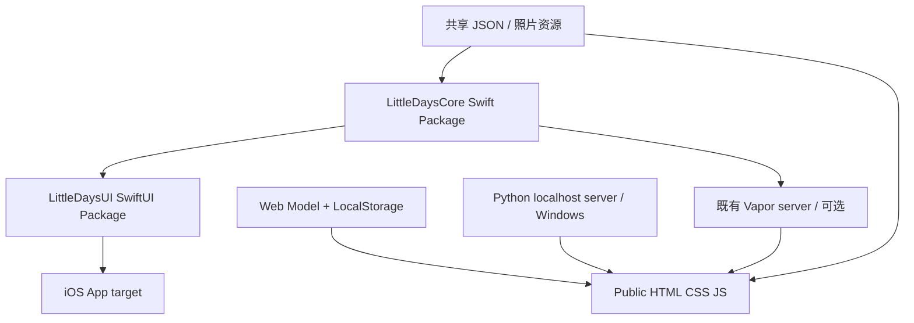

# Little Days · 技术架构与取舍

## 已检查的仓库基础

第一阶段基于 `0f90ced` 的 Swift Package / Vapor 4.110.1 / Public 静态启动页继续开发，保留现有 `start.sh`、`Start.command`、Vapor 服务和测试。没有迁移为 React。

## 可行性评估

| 方案 | Windows 浏览器 | SwiftUI 原生能力 | 取舍 |
| --- | --- | --- | --- |
| Apple SwiftUI 直接渲染 | 不能直接运行 Apple iOS SDK/SwiftUI | 完整，需 Apple SDK | 最终 iPhone 方向；Windows localhost 不承担模拟器职责 |
| SwiftWasm / Tokamak 等兼容层 | 可将部分 Swift UI 代码映射到 DOM/Wasm | 部分 API，照片、手势、持久化等需适配 | 暂不引入；本仓库未验证完整编辑器兼容性，不能承诺直接复用全部 SwiftUI |
| 现有 Vapor + HTML | 可服务 Web 资源；当前只验证 Linux Swift 环境 | 服务层不是 SwiftUI 渲染器 | 保留，适合 Swift 服务开发；不要求 Windows 用户先编译依赖链 |
| 独立轻量 HTML 预览 + 标准库 HTTP 服务 | Windows Python 3 可直接启动 | 独立预览，不运行 SwiftUI | 第一阶段选择：零前端构建依赖，优先验证 UI 与交互 |

采用两个视图实现，共享资源/数据契约与业务规则测试。代价是 UI 需要分别实现；功能矩阵、文档与两端测试负责控制差异。不会把 HTML 渲染结果称为运行中的原生 SwiftUI。

## 模块关系



| 路径 | 职责 |
| --- | --- |
| `Native/LittleDays.xcodeproj` | iOS 17+ App 目标与本地 UI Package 依赖 |
| `Native/App/` | `@main` SwiftUI App 入口 |
| `Native/Sources/LittleDaysUI/` | 五页 SwiftUI、NativeStore、本机文件持久化 |
| `Packages/LittleDaysCore/` | Foundation 模型、日期/打卡/保存规则、共享资源、独立 Swift 测试 |
| `Public/app.js` | Web 页面、导航、编辑器和交互控制 |
| `Public/js/model.mjs` | 日期规则、数据更新、存储事务 |
| `Public/js/export.mjs` | 基础 Canvas PNG 导出、图片读取 |
| `tools/preview.py` | Windows/macOS/Linux 标准库 HTTP 预览，仅暴露 Public 与白名单共享资源 |
| `Sources/NotebookApp/` | 既有 Vapor 配置与相同共享资源路由 |
| `tests/` | Web 业务规则、HTTP 服务和真实浏览器端到端测试 |

原生 UI 依赖独立 Core Package，**不依赖 Vapor**。Windows 用户运行预览不需要 Swift、Node 或 Xcode。Node 与 Playwright 只用于可选的自动化测试。

## 共享资源与数据契约 v1

权威资源目录：`Packages/LittleDaysCore/Sources/LittleDaysCore/Resources/`。

- `design-tokens.json`：颜色、字体类别、基础圆角。
- `features.json`：导航、模板、心情、三个风格的初始贴纸。
- `seed.json`：默认习惯、手帐本和相对今天的示例日记，首次初始化使用。
- `Media/`：仅保存一份示例照片；HTTP `/assets/` 与 Swift Bundle 均读取它。

两端 JSON 字段使用相同名称；日期是设备本地公历 `YYYY-MM-DD`，星期一为每周起点。

```text
DayState { schemaVersion:1, habits:[], books:[], entries:[], checks:[], drafts:{date:JournalEntry} }
Habit { id, title, theme, kind:"completion"|"duration", target:1...7, minutes }
HabitCheck { habitId, date, minutes } // (habitId,date) 唯一
JournalBook { id, title, category, color, cover }
JournalEntry { id,date,title,body,mood,bookId,photo,template,font,layers,isDemo,updatedAt }
StickerLayer { id,kind:"sticker",text,x,y,scale,rotation } // x/y 为纸张百分比，rotation 为角度
```

一日一篇 Journal，保存按日期更新，不重复插入；Growth 是同日期的引用，不复制到 Journal 中。两端保持同名结构，并各自测试去重、周统计、保存语义。

当前没有 Web ↔ iOS 同步或导入功能。结构相同不代表数据已经共享：浏览器数据在 LocalStorage `little-days.v1`，原生文件在 App Application Support 的 `LittleDays/state.json`。

## 持久化与编辑器

- Web 更新先写 LocalStorage 成功，再替换内存 State；失败不可显示成功。损坏/不兼容数据不自动删除。
- 450 ms 自动草稿，导航/关闭前尝试落盘；正式保存删除同日期草稿。撤销/重做仅本次编辑会话，最多 30 步。
- 图片最长边 1000 px，JPEG 压缩；LocalStorage 容量有限，图片较多时需后续迁移到 IndexedDB。
- NativeStore 使用 JSON 原子文件写入；读取失败锁定保存以保护原文件。
- PNG 导出使用 Canvas 固定版式，兼容本地图片与 Emoji 贴纸；字体、长文、胶带旋转等与 DOM 仍有差异。

## 运行与验证边界

Windows：安装 Python 3.10+（建议 3.11+），仓库根目录运行 `py -3 tools/preview.py`，访问 http://localhost:8080 。也可双击 Start-Windows.cmd；仅监听 127.0.0.1。服务器只用于开发预览。

Vapor：`bash start.sh`；当前 Linux + Swift 6.0.3 验证通过。Windows 原生 Swift/Vapor 构建不是本阶段承诺。

原生：macOS + Xcode 16+ 打开 `Native/LittleDays.xcodeproj`，选择 LittleDays / iPhone Simulator。模拟器命令示例：

```bash
xcodebuild -project Native/LittleDays.xcodeproj -scheme LittleDays \
  -destination 'generic/platform=iOS Simulator' CODE_SIGNING_ALLOWED=NO build
```

当前 Linux 环境无法运行这个命令；只做了 SwiftUI 源文件语法解析、Package 清单及 Xcode 项目 plist 结构检查。原生类型检查、iOS 链接、模拟器与真机、Windows 系统实际运行仍须对应平台实测。真机还需用户自己的签名团队，当前工程未配置团队和 App Store 图标。

## 下一步

优先完成原生 iOS 编译验证与照片/贴纸编辑器，再做 IndexedDB/媒体备份、共享导入导出和业务规则的一致性测试。引入 SwiftUI Web 兼容层前须先做可运行的小型验证，不能替换已工作的 Windows 预览。
