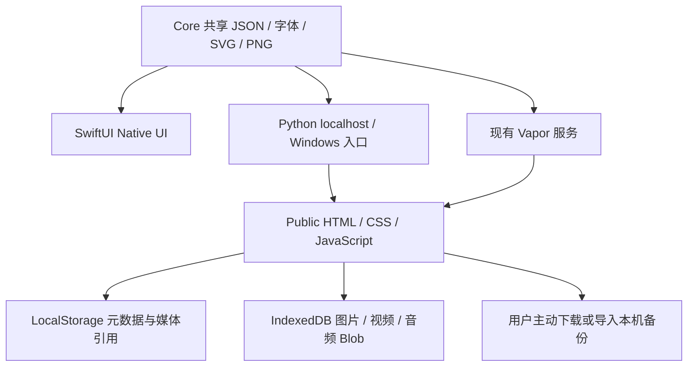

# Little Days · 技术架构与关键决策 V3

## 已检查的基础与原则

在现有 Swift Package / Vapor 4.110.1 / SwiftUI Native / Public HTML 五页上增量开发；本轮基于 `5edaf19`。没有切换 React，没有新建替代项目。

最终 iPhone 是 Swift + SwiftUI。日常查看用 claude.ai 固定链接（2026-11-09 用户确认，取代 Windows localhost:8080 作为查看方式）；网页预览不是 Apple SwiftUI。Apple iOS SDK 无法直接在 Windows 浏览器运行；SwiftWasm/Tokamak 等兼容层的照片/手势/媒体兼容性尚未在本项目验证，因此不引入。保留现有 Vapor，Windows 的日常预览继续使用 Python 标准库，不要求安装 Swift 或 Node。

## 2026-11-07 架构确认：iOS = Swift 外壳 + 同一份 Web 界面

用户确认：最终发布 iOS App，App 是 **SwiftUI + WKWebView 外壳**，运行与 localhost 预览完全相同的 `Public/` HTML/CSS/JavaScript；用户通过 claude.ai 固定链接检查每次更新（2026-11-09 起取代 Windows localhost:8080），不需要 Mac/Xcode。

| 部分 | 说明 |
| --- | --- |
| `Native/App/LittleDaysApp.swift` | 入口改为 `LittleDaysWebShellView()` |
| `Native/Sources/LittleDaysUI/WebShell/` | `LittleDaysSchemeHandler`：`littledays://app/` 自定义协议，路由与 `tools/preview.py` 一致（`/shared`、`/library`、`/assets` 来自 Core 白名单资源，其余来自 `WebApp/`，禁止 `..`/隐藏文件）；`LittleDaysWebCoordinator`：JS `alert/confirm`、麦克风权限、备份/PNG 下载到 Documents 并弹出分享面板、外部链接交给 Safari |
| `Native/Sources/LittleDaysUI/WebApp/` | `Public/` 的副本，由 `tools/sync_native_web.py` 生成；`tests/test_native_shell.py` 检查一致、路由覆盖、入口与权限键 |
| `Native/Package.swift` | `resources: [.copy("WebApp")]` |
| Xcode 工程 | 新增麦克风、相机说明，文件共享（导出的备份可在「文件」中看到） |
| `Public/styles.css` | 外壳注入 `data-shell="ios"`，隐藏“Web 预览”外框，使用真实安全区 |

固定自定义 origin 保证 LocalStorage/IndexedDB 在 App 重启后保留。浏览器（localhost）与 iPhone App 的数据彼此独立，通过备份/恢复迁移。Debug 版可用启动参数 `-LittleDaysDevServer <url>` 改为加载开发服务器（Release 永远加载打包文件）。WKWebView 对自定义协议下 IndexedDB、MediaRecorder 的支持需在 Xcode/真机确认，本轮环境无法验证。

## 当前已经落地



| 模块 | 职责 |
| --- | --- |
| `Packages/LittleDaysCore/` | Swift 共享模型、日期/打卡规则，V3 兼容类型、资源与测试；不依赖 Vapor |
| `Native/` | iOS App 工程、SwiftUI 五页/Settings、文件持久化、共享字体注册、原生 PNG 封面 |
| `Public/app.js` | 既有五页导航、编辑流程，V3 书本/媒体/录音与双语交互 |
| `Public/js/model.mjs` | 元数据、旧格式补全、保存、私人默认、旧标签页检测 |
| `Public/js/media.mjs` | IndexedDB Blob、对象 URL、旧照片迁移、备份/恢复、引用遍历 |
| `Public/js/personal-ui.mjs` | 书本封面/通用字段、媒体卡片、Settings 视图 |
| `Public/js/library.mjs` | 字体/素材查找、封面参数、字段验证 |
| `Public/js/i18n.mjs` | 共享翻译与界面语言偏好，不翻译用户内容 |
| `Public/js/export.mjs` | 基础 Canvas 静态 PNG，支持原图、原创贴纸、独立文字层，V3.1 照片图层尺寸/裁切/相框与成长卡片 |
| `Public/js/day.mjs` | V3.1 纯函数：Moments 增删改序与单独保存、日期摘要、手帐本归类、打卡感想/周月回顾、自动版式与照片图层 |
| `Public/js/canvas.mjs` | V3.1 共享画布与媒体卡片渲染：Studio 编辑模式与 Day Detail 只读模式使用同一套标记 |
| `Public/js/day-view.mjs` | V3.1 Calendar Day Detail 只读回忆页 |
| `Public/js/journey-view.mjs` | V3.2 习惯成长轨迹（书页式阅读） |
| `Public/js/community.mjs` / `community-view.mjs` | V3.3 社区/好友/私信**本机演示**：纯函数与视图；数据存 `little-days.demo-social`，不进入手帐数据、备份或任何网络请求 |
| `tools/merge_font_slices.py` | V3.2 把 OFL 网页字体子集合并回单个 TTF（来源记录） |
| `tools/build_link.py` | 生成在线链接（claude.ai Artifact）用的文件夹 `dist/link/` |
| `tools/preview.py` | 127.0.0.1 HTTP、共享资源白名单、`--open`、完整解压检查 |
| `Start-Windows.cmd` | 自动进入项目目录，检测 Python 3.10+，启动并打开浏览器；无需 Git |
| `tools/sync_tokens.py` / `sync_library.py` | 从共享 JSON 生成颜色回退和字体 CSS，非运行时构建 |

Node/Playwright/fake-indexeddb 仅为可选测试依赖；Python 预览无第三方运行依赖。

## 共享资源

权威目录：`Packages/LittleDaysCore/Sources/LittleDaysCore/Resources/`。

- `design-tokens.json` / `features.json` / `seed.json`：原有设计、五页/模板定义与示例数据。
- `library.json`：七款字体、许可证/来源/SHA-256、23 个原创图形、六种封面、七种字段、六套记录配置。
- `i18n.json`：完整 zh/en 界面词条；Web 和 Native 共用。
- `Fonts/`：原始 TTF 与每份 SIL OFL 文本，不改字体内的作者/保留名称。
- `Stickers/`：原创透明 SVG 与 480px PNG，及原创资产许可；Web 用 SVG，SwiftUI 用 PNG。
- `Media/`：原有公开示例照片。真实用户媒体、备份和密钥均不能进入仓库。

Python/Vapor 只暴露 Public 和白名单共享资源。用户 Blob 位于浏览器 IndexedDB，不是服务器静态目录中的文件。

## 数据契约与兼容

继续读取 `little-days.v1` / `schemaVersion:1`，本次为可选字段扩展，不强制用户重建数据。Swift 新属性可选，旧 JSON 缺少时仍能解码；Web normalize 只补默认值，保留 ID、正文、日期、旧系统字体、Emoji 图层及未知旧属性。

```text
DayState {schemaVersion:1, habits, books, entries, checks, drafts}
Book {id,title,category,color,cover, description?,coverTemplate?,coverFont?,
      coverDecoration?,coverImage?,visibility?,fields?}
BookField {id,label,type,options?,labelZh?,labelEn?}
Entry {原有字段, media?,fieldValues?,textStyle?,bodyFont?,visibility?}
MediaCard {id,kind:"video"|"audio",name,mime,size,duration,source,poster?,origin?:"recording"}
Layer {原有字段, assetId?,mediaRef?,fontId?,fontSize?,color?,weight?,spacing?,align?}
```

### V3.1 增量（仍是 schemaVersion 1，全部可选）

```text
Entry      += moments?: Moment[], layoutTemplate?, layoutEdited?
Moment     {id, title, time, body, mood, tags[], bookId, template, font,
            layers: Layer[], media: MediaCard[], collapsed, layoutTemplate?,
            layoutEdited?, visibility:"private", updatedAt, savedAt?}
Layer      += w?, h?            // % 画布宽 / % 画布高；x/y 仍是中心点 %
              crop?: {x,y,zoom} // object-position % 与 1–4 倍缩放
              frame?: polaroid|border|rounded|bare, tape?: bool
              kind:"growth" + habitId, checkDate   // 引用打卡，不复制
HabitCheck += detail?, note?, mood?, photo?(media:), shareNote?:false, updatedAt?
DayState   += reflections?: [{id, period:"week"|"month", key, wentWell,
                              challenges, learned, nextFocus, updatedAt}]
```

决策：**Day 仍是 Entry（日期容器）**，一天一条 Entry，内部是有序 Moments，避免把一天拆成多条互不相关的 Entry 而打乱 Calendar / My Books / Growth 关联。“页”= 当日主页（保留旧标题/正文/主照片固定版式，旧记录无需迁移）+ 每个 Moment。所有画布坐标为相对画布的百分比，画布固定 4:5，因此不同手机/桌面尺寸恢复一致。

成长卡片是对 `(habitId, date)` 打卡的引用：修改感想处处更新；删除手帐页/Moment 不影响打卡；打卡仍唯一，计数不变。感想默认私人，`shareNote` 为未来分享时的明确授权位，目前没有任何分享出口。

### V5.2 增量（全部可选，旧数据不变）

- 照片图层 `aspect`（原图宽 / 高）；页面（Entry / Moment）`layoutVariant`（0–2）；`layoutTemplate` 新值 `"smart"`（按照片形状自动排，`Public/js/smart-layout.mjs`）、`"line"`（照片 + 一句话）；手绘图层 `drawing: true`；`backdrop` 可以是 `media:`（自己的照片，计入备份引用）。
- 本机测试记录 `little-days.events`（`Public/js/events.mjs`）：只存白名单字段，不上传；实验室开关 `little-days.labs`（"1" = 打开）；已看过的更新版本 `little-days.seen-version`（更新内容在 `Public/js/whats-new.mjs`）。两者都只是本机便利设置，不属于手帐数据，也不进备份。

### V3.1 媒体加载与对象 URL 生命周期

`MediaStore` 以 scope 引用计数对象 URL：`app`（照片、封面、海报、成长照片，用于缩略图）在启动时载入；音视频 Blob 只由打开它们的视图（`studio` 或 `day`）通过 `acquire()` 从 IndexedDB 读取，离开视图 `release()` 暂停播放并撤销仅属于该视图的 URL。Day Detail 不再依赖 Studio 临时状态，刷新或重选日期都会重新从 IndexedDB 生成可播放 URL。恢复备份写入 Blob 时不创建 URL。

### V3.1 容量检查

- 图片导入仍压缩为最长边 1200px 的 JPEG（通常 0.1–0.5 MB/张），单次多选上限 20 张；LocalStorage 只增加每张约 0.3 KB 的坐标元数据。
- 备份媒体上限保持 **100 MB**、导入文件 **150 MB**（Base64 约 +33%，100 MB 媒体 ≈ 134 MB JSON，仍低于导入上限），未放宽。
- 备份媒体**文件数**上限由 500 调整为 **2000**：多照片后 500 个文件可能早于 100 MB 被触发（每天 2 张约 8 个月），总字节上限不变，因此内存风险不变。
- Settings 显示当前引用媒体的数量和大小，超过 80 MB 变色提醒；超过 100 MB 时导出明确失败提示，不会生成不完整备份。分卷备份仍未实现。

`photo`、`coverImage`、卡片 source/poster、图片字段或照片层使用 `media:<UUID>`；真实 Blob 存在 `little-days-media` IndexedDB 的 `media` object store，数据库版本 1。对象 URL 只在当前页面内存使用，刷新时由 Blob 重建，不能把临时 blob URL 持久化当作媒体本体。

### 写入顺序

1. 校验格式/大小；图片缩小并编码 JPEG。
2. IndexedDB 事务完成后才返回媒体 ID。
3. 再写含引用的 LocalStorage 元数据；失败不显示保存成功。
4. 撤销/草稿仍可能引用旧媒体，因此本轮不自动删除被替换 Blob。后续做引用计数、保留期和垃圾回收。

旧 data URI 主照片：先把所有对应 Blob 写成功，再替换元数据。失败时原字符串和记录保留；已经写入但未引用的 Blob 暂时保留，不能以清理为名删除原媒体。

同一天一篇 Journal（V3.1 起其中包含有序 Moments）；HabitCheck 使用 `(habitId,date)` 唯一关联，感想写在同一条打卡上。主题字段使用通用 schema，fieldValues 保留原始值；界面语言变更只翻译标签，不重写用户值。

### 本机备份和恢复

导出 `little-days-backup / version:1` JSON，包含元数据与 Base64 媒体，**只下载到用户本机，不上传服务器**。恢复需用户明确确认；先验证结构与媒体引用，再写新 Blob 并重映射 ID，最后才替换元数据。无效或不完整备份不能清空现有资料；媒体导出上限 100 MB、导入文件上限 150 MB。备份尚未加密，宜保存在用户自己的安全位置。

LocalStorage 保存前比较已读快照，能提示已发生的旧标签页更新；冲突时当前窗口的编辑内容仍在内存，先复制文字或导出图片再刷新。这是本机覆盖检测，不是跨客户端原子事务，也不能当成多人协作版本控制。近同时并发和真正协作需要后端事务中的条件更新。

## 多媒体、字体与语言

- 视频卡片与录音/音频使用浏览器原生 controls；一段媒体播放时暂停其他媒体。切页或重新渲染可能暂停播放，不实现后台音乐。
- 麦克风只在主动点击录音后请求；结束/失败停止音轨；最多 5 分钟/20 MB。当前测试使用 Chromium 的虚拟麦克风和合成视频/音频。
- V6.0 背景音乐：`Public/js/music.mjs` 一个共享播放器（隐藏的 `#background-music`，循环、音量 0.7），文件先 fetch 成 blob URL 再播放（iOS 外壳的自定义 scheme 不支持媒体分段请求）。页面字段 `music` 与书的字段 `music`（V6.2，library.json `music` 的 id，可选）；阅读一天（封面优先，否则第一页，再否则这本书的音乐）、打开书（列表或翻页，页面自己的音乐优先）时自动播放；音量是本机设置 `little-days.music-volume`（默认 0.7），写作时不播放；任何其他音视频开始播放时它被暂停。导出视频时作为循环音轨混入（有其他声音时 0.35，只有音乐时 0.8、15 秒、结尾 1.5 秒淡出）。音乐全部原创，不连接音乐平台、不下载歌曲；视频剪辑、语音转文字仍未实现。
- 字体在 Web 使用本地 TTF `@font-face`，中文回退到授权中文字体/系统；Native 由 CoreText 注册。完整许可证与来源附仓库。
- Settings 的 `little-days.language` 与用户记录分开，日期/数字采用当前 locale。Native 用 UserDefaults 对应偏好和共享翻译；两端偏好不会自动同步。
- PNG 导出是静态画面，不包含可播放的视频/录音；与 DOM 的长文排版、照片边距等仍有差异。

## 未来后端方案（设计，尚未部署）

优先复用 Vapor。建议先以小型验证评估 Fluent + PostgreSQL 的事务/迁移，与 S3 兼容私有对象存储，再确定 Phase 3 选型；本轮不安装数据库或对象存储服务。

### 建议的数据模型

| 领域 | 建议表/实体与关键约束 |
| --- | --- |
| 身份 | users、profiles、sessions；认证密码散列/受支持登录方式，session 哈希与轮换、撤销、基本速率限制 |
| 私人内容 | books、journal_pages、page_versions；ownerId、visibility、revision、软删除时间，内容为版本化 JSON |
| 媒体 | media_objects；ownerId、私有 objectKey、mime/size/hash、授权来源、上传状态；对象 ACL 继承所属页面/明确成员 |
| 发布 | publications / publication_media / contributor_consents；公开的是确认后的页面快照和指定媒体，撤回后停止公开访问 |
| 互动 | comments / likes / bookmarks / follows；评论开关、唯一用户作品点赞、收藏引用，不默认赋予复制许可 |
| 好友与屏蔽 | friend_requests / friendships / blocks；请求状态，双向接受，屏蔽阻止后续请求和私信；好友不是内容 ACL |
| 私信 | conversations / conversation_members / messages；仅成员访问、已接受好友/反骚扰策略、作者删除与未读游标 |
| 协作 | book_memberships / invitations / page_versions；Owner/Editor/Viewer、授权页面范围、revokedAt、退出与移除 |
| 管理 | reports / moderation_actions / audit_events；举报队列、管理最小权限、操作审计与访问日志 |

### 服务端访问矩阵（未来必须测试）

| 资源 | 允许访问者 | 拒绝边界 |
| --- | --- | --- |
| Private 书本/页面 | owner | 关注者、好友、匿名、其他账号均无权 |
| Shared 内容 | owner 与有效成员；Editor 编辑授权范围；Viewer 只读/评论 | 撤销、退出、非成员与越权页访问 |
| Public 作品 | 仅确认发布的快照与媒体 | 不得顺带返回未公开原页、私人金额、录音、媒体源目录 |
| 私信 | 会话参与者，受好友/屏蔽/反骚扰规则约束 | 非参与者、被屏蔽后的新消息、未授权历史/附件 |
| 私有媒体 URL | 每次鉴权后签发短有效期 URL | 不通过隐藏 ID、好友关系或客户端 visibility 代替权限 |

所有资源由服务端校验 owner/member，默认拒绝。没有实际账号和服务端权限测试之前，不能声称真实社交安全已经完成。

### 版本、删除与恢复

- 协作保存带 expectedRevision，数据库事务执行 `UPDATE ... WHERE revision = expected`；失败返回 409，保留双方草稿供比较/另存，不能静默覆盖。
- 最近页面版本保留、贡献者与变更时间；恢复产生新版本而不是抹去历史。
- 协作公开与成员协作分离，相关贡献者明确确认媒体/页面，授权可记录、可撤回；一人不能擅自公开他人私人内容。
- 软删除 + 明确保留期 + 用户主动清空/账号删除流程；备份演练和对象引用清理。保留期与监管要求须在部署前确定，不在本轮声称已实现。
- 退出/移除成员后撤销未来访问，短期签名 URL 需限制有效期；已下载副本无法保证远程抹除。
- 密钥只从运行环境读取；禁止提交真实用户媒体/记录/备份到公开仓库。

## 运行和验证边界

Windows 无 Git：下载仓库 ZIP，全部解压，进入含 Start-Windows.cmd、Public、tools、Packages 的目录，双击 Start-Windows.cmd。手动命令 `py -3 tools\preview.py --open`，地址 http://localhost:8080 。详见 [WINDOWS_PREVIEW.md](WINDOWS_PREVIEW.md)。

Vapor 继续 `bash start.sh`，Swift 6.0+；Native 用 macOS + Xcode 16+ 打开 `Native/LittleDays.xcodeproj`。当前 Linux 验证不能替代 Windows CMD/Python Launcher、iOS SDK 构建、模拟器或真机。

## 2026-11-09 提案：Quick Create v3 的技术增量（V6.3 已实施 P0 ①：exif.mjs、day-story.mjs、story 页面、timeline 封面；V6.5 Quick Create V2 见下）

见 [QUICK_CREATE_PLAN.md](QUICK_CREATE_PLAN.md) §8。要点：不换技术栈、不重写；新增纯模块 `day-story.mjs`（按时间分组、选模板、封面时间线、装饰空位）和 `exif.mjs`（在 `imageBlob()` 缩图前读拍摄时间，因为 canvas 重新编码会丢 EXIF）；扩展 `smart-layout.mjs`（新模板、钉住图层当障碍物、文字量测）；数据只加可选字段（页面 `capturedAt` / `kit` / `alsoIn` / `habitId` / `fieldValues`，图层 `pinned`，封面 `layoutTemplate: "timeline"`），schemaVersion 不变、不迁移，自动封面只在封面为空时写入；原生 PhotoKit 桥接列为 P1。Vapor、IndexedDB 不变。

## 2026-11-09 V6.5 Quick Create V2 · Scrapbook 排版引擎

- `Public/js/scrapbook-layout.mjs`（纯函数，可单测）：`layoutMoment(input, style, variant)` 返回每个照片 / 视频图层的位置（x、y、w、h、旋转、相框、胶带）+ 生成的文字图层；`layoutDay(moments, style, variant)` 生成「当天跨页」（每个 Moment 一张代表照片，最多 4 个，其余显示「还有 N 个」）；`boundText(layer, page)` 读出绑定文字。
- 三种风格是三套构图逻辑：editorial（主图 + 不对称 + 行排列，照片不重叠）、cozy（拍立得散落 / 宽松网格，倾斜、胶带）、playful（拼贴打包：每张与最近的一张相接、重叠 ≤ 12%，柔色背景）。相框高度按照片比例和相框内边距计算（`frameHeight`），所以不裁切；文字按字数估算行数（`textBlock` / `fitText`），自动缩小并预留空间；内容少时整体放到视觉中心。
- 数据（全部可选，schemaVersion 不变）：页面 `layoutTemplate: "scrapbook"`、`layoutStyle`；图层 `gen`（引擎生成，重排时替换）、`bind`（"title" / "time"）、`of`（跨页上指向的 Moment id）、`excerpt`、`prefix`、`chip`。绑定文字在 canvas.mjs 和 export.mjs 里都从页面 / Moment 读取，所以预览、阅读、翻书、PDF、自由编辑改的是同一份文字；自由编辑里改绑定文字会写回 Moment 的 title。
- 手动调整保护：拖动 / 缩放已有的 `layoutEdited` 标记；换风格时如有这样的页会先确认（取消 = 保留这些页），重新排版也会确认。旧页面（smart / timeline / text）照旧显示，不迁移。

## 2026-11-09 V6.6 成长合并

- features.json 的 growth tab 加 `"inNav": false`（Swift `NavigationTab.inNav` 可选），网页导航过滤掉它；页面 `growth` / `journey` 仍然存在，高亮在「书架」。
- 状态新增可选 `plans: { [date]: [{ id, text, done }] }`（Swift `JournalState.plans: [String: [DayPlan]]?`），schemaVersion 不变；旧数据没有该字段照常读取。今日清单是读取 checks + plans 的派生视图，不写入页面图层（所以不会影响「当天跨页」只在封面为空时生成的规则）。

## 2026-11-09 V6.7 照片互换 / 替换

- 互换：Studio 拖动（mode "move"）时用指针位置找下面最上层的照片（`swapCandidate`），松手时 `swapPhotos`：A 放到 B 的中心与倾斜，B 放到 A 拖动前的位置，各自用 `fitPhoto(aspect, 对方框宽, 对方框高, 自己的相框)` 缩放（不裁切），并交换叠放顺序；进入撤销历史，标记 `layoutEdited`。
- 替换：图层工具条「替换」走已有的 `replace` 上传；新照片保留位置，用 `fitPhoto` 在旧框内按新比例重算 w / h，记录 `aspect`。
- 杂志：`boundText` 支持 `prefix: "kicker"`（时间 + 英文时段）；`layoutMoment` 接受 `folio`，`layoutDay` 接受 `issue`。`story-style.layerBox` 的文字高度按行数估算，装饰不再压到多行文字。
- 我的相册（Quick Create）：`startQuickRecord` 先 `chooseAttachment({kind:"quick", book, date})`，`handleImageUpload` 收到照片后才 `startPage`；`#attachment-image-input` 的 `cancel` 事件只在来自面板时重开面板（`lastQuick.fromHome` 区分）。
- 保存后 `showSavedPage()`：按 `activePage()` 的 bookId 与 moment id 在 `flipPages(book)` 里找到位置，切到 books / flip。
- 首页 `todayPeekHTML(entry)`：封面（有内容时）+ 各 Moment，最多 12 张；滚动用捕获阶段的 document scroll 监听更新圆点。
- 字体：Moment 也可有可选 `bodyFont`（Swift `JournalMoment.bodyFont`），正文渲染 / 导出读 `bodyFont || font`。

## 2026-11-09 V6.8 首页 planner、更新记录

- `todayListHTML()` 只渲染 planner（`plansOf` / `savePlans`，不再看 `labsOn`）和 `.today-habits-link`（`data-action="nav" data-page="growth"`）。
- `newsSectionHTML()` 在设置渲染时读 `hasUnseen()` 再 `markSeen()`；首页齿轮 `.settings-gear .news-dot` 由 `hasUnseen()` 决定。`whatsNewCardHTML` 与 `whats-new-dismiss` 已移除。

## 2026-11-09 V6.9 今日清单进导出

- `dayListItems(date)`（app.js）= 当天打卡习惯的 `title` + 做完的 `plans`；翻书页、导出共用。
- `renderJournalCanvas(page, { dayList, dayListTitle })` 有清单时返回加高的画布（`withDayList`）；`buildPdf` 每页 MediaBox 高度 = 432 × 图片高 / 图片宽。

## 2026-11-09 V7.0 todayPeekHTML

- 按页面顺序收集照片引用（backdrop、封面 photo、非 `gen` / 非手绘照片图层），用 Set 去重；每个引用一张卡，无照片但有文字的页面一张卡；`data-moment` 指向所在页。

## 2026-11-09 V7.2 隐私开关

- 本机键：`little-days.share-list`、`little-days.hide-today`（"1" 为开，缺省为关）；`privacyOn(name)` 在导出（`exportOptionsFor`、导出图片）与首页（`todayPeekHTML`）读取。不进入 `little-days.v1`，不需要 Swift 模型字段。

## 2026-11-10 V7.4 App 锁

- `Public/js/app-lock.mjs`：纯函数（SHA-256、makeLock / checkPin / readLock / saveLock / shouldRelock / pauseLeft）。本机键 `little-days.lock`（`{v:1, salt, hash, grace, biometric}`）、`little-days.lock-tries`。不进 `little-days.v1`、不进备份，因此不需要 Swift 模型字段。
- 网页 ↔ iOS：`window.webkit.messageHandlers.littleDaysLock.postMessage({type:"unlock"|"state"})`；iOS 回调 `window.littleDaysBiometricResult(ok)`；启动时注入 `window.littleDaysBiometry = "faceID"|"touchID"|""`。Swift：`LittleDaysLockBridge`（LocalAuthentication）、`LittleDaysPrivacy`（App 切换器封面）。Info.plist：`NSFaceIDUsageDescription`。
