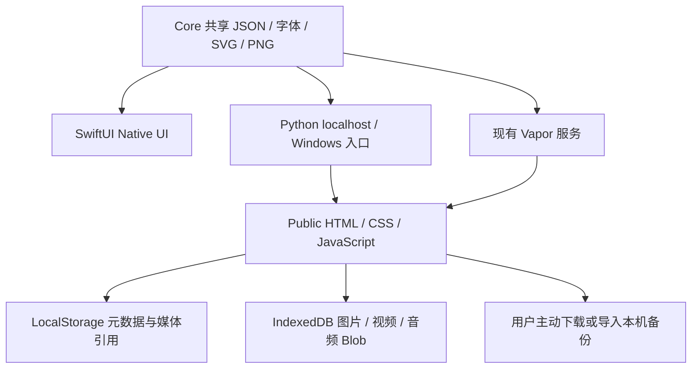

# Little Days · 技术架构与关键决策 V3

## 已检查的基础与原则

在现有 Swift Package / Vapor 4.110.1 / SwiftUI Native / Public HTML 五页上增量开发；本轮基于 `5edaf19`。没有切换 React，没有新建替代项目。

最终 iPhone 是 Swift + SwiftUI。Windows localhost 是独立交互 HTML 预览，不是 Apple SwiftUI。Apple iOS SDK 无法直接在 Windows 浏览器运行；SwiftWasm/Tokamak 等兼容层的照片/手势/媒体兼容性尚未在本项目验证，因此不引入。保留现有 Vapor，Windows 的日常预览继续使用 Python 标准库，不要求安装 Swift 或 Node。

## 当前已经落地



| 模块 | 职责 |
| --- | --- |
| `Packages/LittleDaysCore/` | Swift 共享模型、日期/打卡规则，V3 兼容类型、资源与测试；不依赖 Vapor |
| `Native/` | iOS App 工程、SwiftUI 五页/Settings、文件持久化、共享字体注册、原生 PNG 封面 |
| `Public/app.js` | 既有五页导航、编辑流程，V3 书本/媒体/录音与双语交互 |
| `Public/js/model.mjs` | 元数据、旧格式补全、保存、私人默认、旧标签页检测 |
| `Public/js/media.mjs` | IndexedDB Blob、对象 URL、旧照片迁移、备份/恢复、引用遍历 |
| `Public/js/personal-ui.mjs` | 书本封面/通用字段、媒体卡片、Settings 视图 |
| `Public/js/library.mjs` | 字体/素材查找、封面参数、字段验证 |
| `Public/js/i18n.mjs` | 共享翻译与界面语言偏好，不翻译用户内容 |
| `Public/js/export.mjs` | 基础 Canvas 静态 PNG，支持原图、原创贴纸与独立文字层 |
| `tools/preview.py` | 127.0.0.1 HTTP、共享资源白名单、`--open`、完整解压检查 |
| `Start-Windows.cmd` | 自动进入项目目录，检测 Python 3.10+，启动并打开浏览器；无需 Git |
| `tools/sync_tokens.py` / `sync_library.py` | 从共享 JSON 生成颜色回退和字体 CSS，非运行时构建 |

Node/Playwright/fake-indexeddb 仅为可选测试依赖；Python 预览无第三方运行依赖。

## 共享资源

权威目录：`Packages/LittleDaysCore/Sources/LittleDaysCore/Resources/`。

- `design-tokens.json` / `features.json` / `seed.json`：原有设计、五页/模板定义与示例数据。
- `library.json`：七款字体、许可证/来源/SHA-256、23 个原创图形、六种封面、七种字段、六套记录配置。
- `i18n.json`：完整 zh/en 界面词条；Web 和 Native 共用。
- `Fonts/`：原始 TTF 与每份 SIL OFL 文本，不改字体内的作者/保留名称。
- `Stickers/`：原创透明 SVG 与 480px PNG，及原创资产许可；Web 用 SVG，SwiftUI 用 PNG。
- `Media/`：原有公开示例照片。真实用户媒体、备份和密钥均不能进入仓库。

Python/Vapor 只暴露 Public 和白名单共享资源。用户 Blob 位于浏览器 IndexedDB，不是服务器静态目录中的文件。

## 数据契约与兼容

继续读取 `little-days.v1` / `schemaVersion:1`，本次为可选字段扩展，不强制用户重建数据。Swift 新属性可选，旧 JSON 缺少时仍能解码；Web normalize 只补默认值，保留 ID、正文、日期、旧系统字体、Emoji 图层及未知旧属性。

```text
DayState {schemaVersion:1, habits, books, entries, checks, drafts}
Book {id,title,category,color,cover, description?,coverTemplate?,coverFont?,
      coverDecoration?,coverImage?,visibility?,fields?}
BookField {id,label,type,options?,labelZh?,labelEn?}
Entry {原有字段, media?,fieldValues?,textStyle?,bodyFont?,visibility?}
MediaCard {id,kind:"video"|"audio",name,mime,size,duration,source,poster?}
Layer {原有字段, assetId?,mediaRef?,fontId?,fontSize?,color?,weight?,spacing?,align?}
```

`photo`、`coverImage`、卡片 source/poster、图片字段或照片层使用 `media:<UUID>`；真实 Blob 存在 `little-days-media` IndexedDB 的 `media` object store，数据库版本 1。对象 URL 只在当前页面内存使用，刷新时由 Blob 重建，不能把临时 blob URL 持久化当作媒体本体。

### 写入顺序

1. 校验格式/大小；图片缩小并编码 JPEG。
2. IndexedDB 事务完成后才返回媒体 ID。
3. 再写含引用的 LocalStorage 元数据；失败不显示保存成功。
4. 撤销/草稿仍可能引用旧媒体，因此本轮不自动删除被替换 Blob。后续做引用计数、保留期和垃圾回收。

旧 data URI 主照片：先把所有对应 Blob 写成功，再替换元数据。失败时原字符串和记录保留；已经写入但未引用的 Blob 暂时保留，不能以清理为名删除原媒体。

同一天一篇 Journal；HabitCheck 使用 `(habitId,date)` 唯一关联。主题字段使用通用 schema，fieldValues 保留原始值；界面语言变更只翻译标签，不重写用户值。

### 本机备份和恢复

导出 `little-days-backup / version:1` JSON，包含元数据与 Base64 媒体，**只下载到用户本机，不上传服务器**。恢复需用户明确确认；先验证结构与媒体引用，再写新 Blob 并重映射 ID，最后才替换元数据。无效或不完整备份不能清空现有资料；媒体导出上限 100 MB、导入文件上限 150 MB。备份尚未加密，宜保存在用户自己的安全位置。

LocalStorage 保存前比较已读快照，能提示已发生的旧标签页更新；冲突时当前窗口的编辑内容仍在内存，先复制文字或导出图片再刷新。这是本机覆盖检测，不是跨客户端原子事务，也不能当成多人协作版本控制。近同时并发和真正协作需要后端事务中的条件更新。

## 多媒体、字体与语言

- 视频卡片与录音/音频使用浏览器原生 controls；一段媒体播放时暂停其他媒体。切页或重新渲染可能暂停播放，不实现后台音乐。
- 麦克风只在主动点击录音后请求；结束/失败停止音轨；最多 5 分钟/20 MB。当前测试使用 Chromium 的虚拟麦克风和合成视频/音频。
- 可选背景音乐、视频剪辑、语音转文字均未实现；没有连接音乐平台或下载歌曲。
- 字体在 Web 使用本地 TTF `@font-face`，中文回退到授权中文字体/系统；Native 由 CoreText 注册。完整许可证与来源附仓库。
- Settings 的 `little-days.language` 与用户记录分开，日期/数字采用当前 locale。Native 用 UserDefaults 对应偏好和共享翻译；两端偏好不会自动同步。
- PNG 导出是静态画面，不包含可播放的视频/录音；与 DOM 的长文排版、照片边距等仍有差异。

## 未来后端方案（设计，尚未部署）

优先复用 Vapor。建议先以小型验证评估 Fluent + PostgreSQL 的事务/迁移，与 S3 兼容私有对象存储，再确定 Phase 3 选型；本轮不安装数据库或对象存储服务。

### 建议的数据模型

| 领域 | 建议表/实体与关键约束 |
| --- | --- |
| 身份 | users、profiles、sessions；认证密码散列/受支持登录方式，session 哈希与轮换、撤销、基本速率限制 |
| 私人内容 | books、journal_pages、page_versions；ownerId、visibility、revision、软删除时间，内容为版本化 JSON |
| 媒体 | media_objects；ownerId、私有 objectKey、mime/size/hash、授权来源、上传状态；对象 ACL 继承所属页面/明确成员 |
| 发布 | publications / publication_media / contributor_consents；公开的是确认后的页面快照和指定媒体，撤回后停止公开访问 |
| 互动 | comments / likes / bookmarks / follows；评论开关、唯一用户作品点赞、收藏引用，不默认赋予复制许可 |
| 好友与屏蔽 | friend_requests / friendships / blocks；请求状态，双向接受，屏蔽阻止后续请求和私信；好友不是内容 ACL |
| 私信 | conversations / conversation_members / messages；仅成员访问、已接受好友/反骚扰策略、作者删除与未读游标 |
| 协作 | book_memberships / invitations / page_versions；Owner/Editor/Viewer、授权页面范围、revokedAt、退出与移除 |
| 管理 | reports / moderation_actions / audit_events；举报队列、管理最小权限、操作审计与访问日志 |

### 服务端访问矩阵（未来必须测试）

| 资源 | 允许访问者 | 拒绝边界 |
| --- | --- | --- |
| Private 书本/页面 | owner | 关注者、好友、匿名、其他账号均无权 |
| Shared 内容 | owner 与有效成员；Editor 编辑授权范围；Viewer 只读/评论 | 撤销、退出、非成员与越权页访问 |
| Public 作品 | 仅确认发布的快照与媒体 | 不得顺带返回未公开原页、私人金额、录音、媒体源目录 |
| 私信 | 会话参与者，受好友/屏蔽/反骚扰规则约束 | 非参与者、被屏蔽后的新消息、未授权历史/附件 |
| 私有媒体 URL | 每次鉴权后签发短有效期 URL | 不通过隐藏 ID、好友关系或客户端 visibility 代替权限 |

所有资源由服务端校验 owner/member，默认拒绝。没有实际账号和服务端权限测试之前，不能声称真实社交安全已经完成。

### 版本、删除与恢复

- 协作保存带 expectedRevision，数据库事务执行 `UPDATE ... WHERE revision = expected`；失败返回 409，保留双方草稿供比较/另存，不能静默覆盖。
- 最近页面版本保留、贡献者与变更时间；恢复产生新版本而不是抹去历史。
- 协作公开与成员协作分离，相关贡献者明确确认媒体/页面，授权可记录、可撤回；一人不能擅自公开他人私人内容。
- 软删除 + 明确保留期 + 用户主动清空/账号删除流程；备份演练和对象引用清理。保留期与监管要求须在部署前确定，不在本轮声称已实现。
- 退出/移除成员后撤销未来访问，短期签名 URL 需限制有效期；已下载副本无法保证远程抹除。
- 密钥只从运行环境读取；禁止提交真实用户媒体/记录/备份到公开仓库。

## 运行和验证边界

Windows 无 Git：下载仓库 ZIP，全部解压，进入含 Start-Windows.cmd、Public、tools、Packages 的目录，双击 Start-Windows.cmd。手动命令 `py -3 tools\preview.py --open`，地址 http://localhost:8080 。详见 [WINDOWS_PREVIEW.md](WINDOWS_PREVIEW.md)。

Vapor 继续 `bash start.sh`，Swift 6.0+；Native 用 macOS + Xcode 16+ 打开 `Native/LittleDays.xcodeproj`。当前 Linux 验证不能替代 Windows CMD/Python Launcher、iOS SDK 构建、模拟器或真机。
